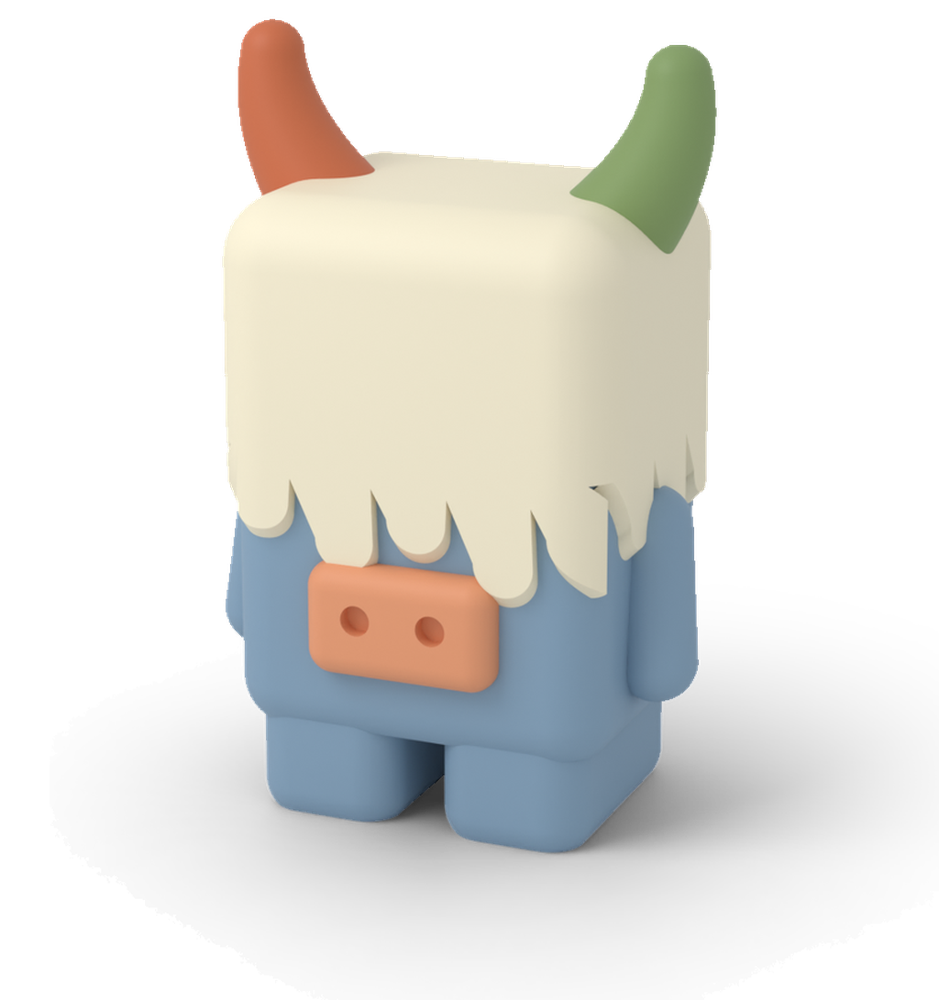

  

<h1 align="center">Yak</h1>

  <strong>Yak is an autonomous coding agent for papercuts, a line-by-line PR reviewer, and a per-branch preview server. One shared sandbox fleet powers all three workflows.</strong>

  <a href="LICENSE">MIT License</a> &middot;
  <a href="CONTRIBUTING.md">Contributing</a> &middot;
  <a href="https://geocodio.github.io/yak/">Documentation</a>

---

## What It Does

- **Opens PRs for review.** Takes work from Slack, Linear, Sentry, GitHub, forwarded email and the dashboard; runs Claude in an isolated sandbox; opens a pull request and waits for CI
- **Works in threads.** Each piece of work is a thread you can steer while Claude works, split into sub-threads, or spread across several repositories with one pull request per repository
- **Moves between Yak and your computer.** Teleport a Claude Code session to Yak and back with the `yak` command, or open a shell in the sandbox with `yak ssh`
- **Reviews pull requests.** Line-level comments, `suggestion` blocks, and a feedback dashboard
- **Serves previews.** A thread shows a live preview of its work, and every open PR gets its own URL behind sign-in that hibernates when idle
- **Shared sandbox fleet.** One Incus + ZFS substrate, one GitHub App, one Inertia dashboard, one cost model across all workflows
- **Uses your Claude accounts.** Each person adds their own Claude account, and each thread runs on one fixed account

## How It Works

  

## Quick Start

See the [Setup Guide](https://geocodio.github.io/yak/setup/) for provisioning a fresh server with Ansible, or the [Development Guide](https://geocodio.github.io/yak/development/) for running Yak locally.

## Channel Support

| Channel  | Input (receive tasks) | Notifications (send updates) |
|----------|-----------------------|------------------------------|
| Slack    | Yes                   | Yes                          |
| Linear   | Yes                   | Yes                          |
| Sentry   | Yes                   | --                           |
| GitHub   | Yes (PR review events)| Yes (PR reviews, comments)   |
| Email    | Yes                   | Yes                          |
| Dashboard| Yes                   | Yes (push notifications)     |

## Design Philosophy

- **Laravel-native** -- built on Laravel 13, Inertia 3, and React on `@geocodio/console-ui`.
- **Channel-agnostic** -- driver-based architecture makes it easy to add new input and notification channels.
- **State machine driven** -- every task follows a defined lifecycle with explicit transitions.
- **AI-assisted, human-supervised** -- tasks are automated but observable through the dashboard and notifications.

## Documentation

Full documentation is hosted at **[geocodio.github.io/yak](https://geocodio.github.io/yak/)**.

- [Concepts](https://geocodio.github.io/yak/concepts/)
- [Threads](https://geocodio.github.io/yak/threads/)
- [Multi-repo threads](https://geocodio.github.io/yak/multi-repo/)
- [Sub-threads](https://geocodio.github.io/yak/sub-threads/)
- [Previews](https://geocodio.github.io/yak/previews/)
- [Teleport](https://geocodio.github.io/yak/teleport/)
- [SSH and terminal](https://geocodio.github.io/yak/ssh/)
- [yak CLI](https://geocodio.github.io/yak/cli/)
- [Claude accounts](https://geocodio.github.io/yak/claude-accounts/)
- [Notifications](https://geocodio.github.io/yak/notifications/)
- [PR Review](https://geocodio.github.io/yak/pr-review/)
- [Channels](https://geocodio.github.io/yak/channels/)
- [Repositories](https://geocodio.github.io/yak/repositories/)
- [Repository config](https://geocodio.github.io/yak/repo-config/)
- [Prompting](https://geocodio.github.io/yak/prompting/)
- [Setup](https://geocodio.github.io/yak/setup/)
- [Upgrading to threads](https://geocodio.github.io/yak/upgrading/)
- [Operations](https://geocodio.github.io/yak/operations/)
- [Architecture](https://geocodio.github.io/yak/architecture/)
- [Troubleshooting](https://geocodio.github.io/yak/troubleshooting/)
- [Development](https://geocodio.github.io/yak/development/)

## Contributing

We welcome contributions! Please read our [Contributing Guide](CONTRIBUTING.md) to get started.

## License

Yak is open-sourced software licensed under the [MIT license](LICENSE).

Copyright 2026 Geocodio
