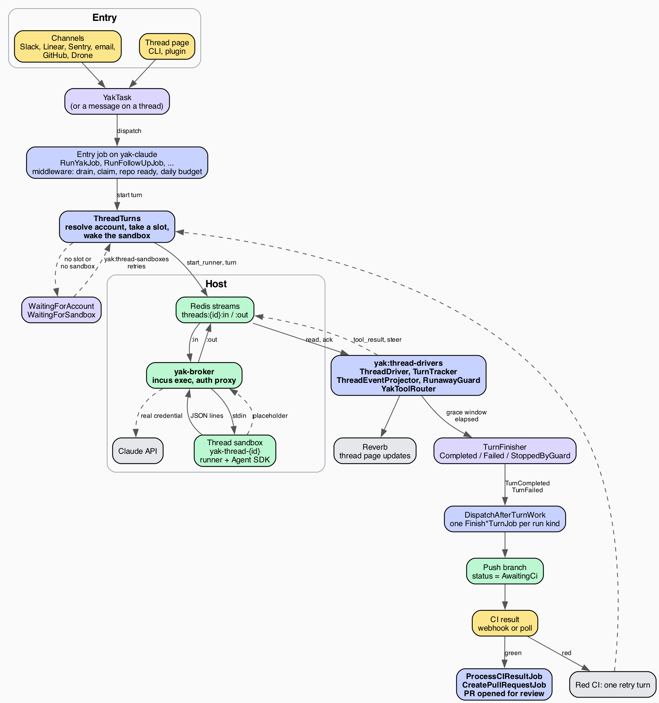

# Architecture

How Yak works inside. Read this page to build a mental model before you trust Yak, to debug unexpected behavior, or to change the code. For the user-facing view of threads and turns, see [Concepts](concepts.md).

## Overview

Yak is a Laravel app, a Go broker and a Node runner. The app takes work from channels and the web UI, the broker runs one Agent SDK process per thread inside an Incus sandbox, and Redis streams connect the two.

| Component | Where it runs | What it does |
|---|---|---|
| Yak app | Docker container `yak` (nginx, php-fpm, queue workers, scheduler) | Dashboard, webhooks, jobs, thread state, PR creation |
| `yak:thread-drivers` | Supervisor program in the `yak` container | Reads runner output from Redis, advances turns, publishes events |
| `yak:credential-socket` | Supervisor program in the `yak` container | Hands the real credential for a placeholder to the broker |
| Reverb | Supervisor program `reverb` in the `yak` container, port 8080 | Websocket updates for the thread page |
| `yak-broker` | systemd unit on the host (Go, `broker/`) | Runs runners in sandboxes with `incus exec`, runs the auth proxy |
| Runner | Node process inside each thread sandbox (`runner/`) | Drives the Claude Agent SDK, exposes the Yak tools |
| Redis | Docker container `yak-redis` | Queues, broker streams, telemetry |
| MariaDB | Docker container `yak-mariadb` | All durable state |
| Incus | Host | Sandboxes, template snapshots, ZFS volumes, the sandbox network ACL |
| SSH jump host | systemd units `yak-jump-sshd`, `yak-wake`, `yak-termbridge` | `yak ssh` and the browser terminal |

The wire protocol between app and broker is in `broker/PROTOCOL.md`. Operator tasks for each component are in [Operations](operations.md).

## The thread model

A **thread** is one conversation about one body of work. It owns:

- one sandbox (`yak-thread-{id}`), woken, paused, stopped and destroyed over its life;
- one runner process and one Claude **session** (the SDK conversation), stored in the session store;
- one fixed Claude account, chosen when the thread starts and never switched.

Work happens in **turns**. A turn is one `task_runs` row: a prompt goes in, the runner works until it has nothing left to do, and the turn ends. Each turn has a kind (`initial`, `retry`, `follow_up`, `clarification`, `research`, `repository_event`, plus `review` and `setup`, which do not run in a thread).

Channels still create **tasks** (`tasks` table, model `YakTask`). Every task belongs to a thread and runs as one or more turns in it. The task carries the channel-facing state (see [the task state machine](#the-task-state-machine)); the turn carries the runner-facing state (`TurnState`: `pending`, `waiting_for_account`, `waiting_for_sandbox`, `running`, `completed`, `failed`, `stopped_by_guard`, `interrupted`).

A thread also has a runner state (`RunnerState`: none, starting, idle, busy, stopping) and a sandbox state (`ThreadSandboxState`: none, starting, running, paused, stopped, destroying, destroyed).

## The life of a turn

1. **Entry job.** A channel or the web UI creates a `YakTask`. A job on the `yak-claude` queue picks it up: `RunYakJob`, `RunFollowUpJob`, `RetryYakJob`, `ResearchYakJob`, `ResearchFollowUpJob` or `StartRepositoryTurnJob`. Middleware runs first: `PausesDuringDrain`, `ClaimsTaskAtomically` (one worker claims a task), `PreventBranchOverlap`, `EnsureRepoReady` and `EnsureDailyBudget`. The job then calls `startThreadTurn()` (`StartsThreadTurns`).
2. **`ThreadTurns`.** `ThreadTurns::start` creates the turn. `ClaudeAccountResolver` picks the account. `AccountConcurrency` takes one of the account's turn slots (`max_concurrent_turns`, default 16; the slot is `task_runs.account_slot_held_at`). `ThreadSandbox::ensureAwake` wakes the sandbox. If no slot is free the turn is `waiting_for_account`; if the sandbox cannot wake (capacity, or a rebuild in progress) it is `waiting_for_sandbox`. `ThreadTurns::resumeWaiting` retries waiting turns.
3. **Streams.** `ThreadTurns::dispatchTurn` writes `start_runner` and `turn` to the Redis stream `threads:{id}:in` through `RedisBrokerStreams` (the `BrokerStreams` contract). The start command carries a placeholder, never a credential.
4. **Broker and runner.** `yak-broker` reads `:in`, checks the mounted credentials file (see [Credentials](#credentials)), starts the runner in the sandbox with `incus exec`, and forwards commands to its stdin. Everything the runner prints, plus lines the broker writes itself (`broker.*`), goes to `threads:{id}:out`. The runner builds the Agent SDK options: the `claude_code` system prompt preset with Yak's text appended, `settingSources` of user, project and local (so the repo's `CLAUDE.md` loads), `permissionMode: bypassPermissions`, `resume` for an existing session, the MCP servers from the sandbox's `mcp-config.json`, and the in-process `yak` tool server.
5. **Thread drivers.** `yak:thread-drivers` (`ThreadDriversCommand`) reads `:out` for every registered channel and passes each entry to `ThreadDriver::handle`, then acknowledges it and trims the stream. A failing entry blocks only its own channel, is retried, and after three failures moves to `:dead`. `ThreadDriver` applies each line through `TurnTracker`, `ThreadEventProjector` (events table), `DeltaBatcher` and `ThreadEventPublisher` (Reverb), `RunawayGuard`, and `YakToolRouter` for tool calls. `ThreadDriver::tick` runs on every loop for timeouts.
6. **End of turn.** `TurnTracker` decides when the turn is over. It needs at least one `result` line, no open tool calls, every message of the turn settled, and no background task running, and then it waits out a grace window after the last activity (`YAK_THREADS_TURN_GRACE_SECONDS`, default 30) in case more output arrives. A result that classifies as an account failure ends the turn at once. `TurnFinisher::finish` moves the turn to `completed` or `failed` and fires `TurnCompleted` or `TurnFailed`.
7. **After-turn jobs.** `DispatchAfterTurnWork` claims `completion_dispatched_at` (so the work runs once) and queues one finisher on `yak-claude` by turn kind:

   | Turn kind | Job |
   |---|---|
   | `initial`, `clarification` | `FinishRunYakTurnJob` |
   | `follow_up` | `FinishFollowUpTurnJob` (`FinishResearchFollowUpTurnJob` for a research task) |
   | `retry` | `FinishRetryTurnJob` |
   | `research` | `FinishResearchTurnJob` |
   | `repository_event` | `FinishRepositoryTurnJob` |

   A turn stopped by the guard or interrupted by a person gets no finisher. All finishers extend `FinishThreadTurnJob`, which wakes the sandbox, works through a `SandboxShell`, and lets it pause again.
8. **Push and CI.** For a fix turn the finisher refuses to push from the default branch, runs `git push origin {branch}` in the sandbox, and sets the task to `awaiting_ci` (for a repo with no CI it goes straight on). Yak pushes, not Claude: the system prompt forbids remote git operations.
9. **CI result.** A CI webhook, `yak:poll-drone-ci` (Drone) or `yak:scan-ci` delivers the result to `ProcessCIResultJob`. `yak:timeout-ci` fails a task that waits longer than `YAK_CI_TIMEOUT_MINUTES` (default 30); for GitHub Actions it first checks whether the newest commit still has a queued or running workflow and keeps waiting up to `YAK_CI_MAX_WAIT_MINUTES` (default 180). Green hands off to `CreatePullRequestJob`. Red starts one retry turn (`RetryYakJob`), so at most two attempts (`YAK_MAX_ATTEMPTS`). In a multi-repo thread `OpenRepositoryPullRequestJob`, `RetryRepositoryCiJob` and `RefreshSiblingBlocksJob` (`app/Jobs/Threads/`) do the per-repository work.
10. **PR.** `CreatePullRequestJob` opens the PR through the GitHub App. Humans review and merge it.

**One-shot runs.** PR review and repository setup have no thread. `BrokerAgentRunner` (bound to `AgentRunner`) runs them through `OneShotRuns` on the stream channel `runs:{taskRunId}`, in the job's own sandbox, on an unattended account (the request's, else the repository's, else the global system account). The run holds one account slot while it runs. Neither has a finisher.

**Queues.** Workers run `queue:work redis`:

| Queue | Processes | Timeout | Used for |
|---|---|---|---|
| `yak-claude` | 4 | 3600 s | entry jobs, after-turn jobs, setup, review |
| `default` | 3 | 30 s | CI results, PR creation, notifications, webhooks |
| `yak-render` | 1 | 900 s | walkthrough renders |
| `yak-deployments` | 2 | 900 s | branch deployments |
| `yak-poll` | 1 | 600 s | polling |

## Steering and tool calls

**Steering.** A message sent while a turn runs is stored as a `pending_steering_messages` row with a uuid. `ThreadTurns::steer` calls `SteeringDelivery::deliver`, which writes a `steer` command to `:in` when the runner is idle or busy; the runner hands it to the SDK mid-turn. `ThreadTurnMessage` tracks the uuid through the runner's lifecycle lines (sent, queued, started, completed, cancelled), and `TurnTracker` will not end the turn until every uuid has settled. If no turn is running the message stays queued and becomes the next prompt.

**Runner loss.** If the runner exits or the broker restarts mid-turn, `RunnerRecovery` restarts it with the session resumed and re-sends messages that never started. Restarts are capped per turn (`YAK_THREADS_RUNNER_RESTART_CAP`, default 3) and back off; past the cap the turn fails.

**Yak tools.** The runner exposes an MCP server named `yak`. A call becomes a `yak.tool_call` line on `:out`; `ThreadDriver` routes it through `YakToolRouter` and writes the answer back as a `tool_result` command.

| Tool | Handled by | Does |
|---|---|---|
| `spawn_thread` | `StackToolRouter` | Starts a sub-thread with its own sandbox |
| `send_message` | `StackToolRouter` | Messages another thread in the stack |
| `list_threads` | `StackToolRouter` | Lists the stack |
| `add_repository` | `MultiRepoToolRouter` (`AddRepository`) | Clones another repository into the sandbox |
| `set_merge_order` | `MultiRepoToolRouter` (`MergeOrder`) | Records the order to merge the PRs |
| `request_refresh` | `RefreshToolRouter` | Runs the refresh commands from `.yak/` |

## Credentials

Real credentials never enter a sandbox.

- **Placeholders.** `AuthProxyPlaceholders` issues a placeholder (`yakph-` plus 32 random bytes) bound to one subject (a thread or a run), one account and one sandbox address. Only the newest placeholder of a subject is live. It stops resolving when the container changes or the thread closes. Only its sha256 is stored.
- **Auth proxy.** The sandbox sends Anthropic requests to `http://10.100.0.1:8787`. The auth proxy inside `yak-broker` asks for the credential behind the placeholder, swaps it in, and forwards the request upstream. It caches a credential for 30 seconds.
- **Credential socket.** The broker redeems placeholders over a Unix socket served by `yak:credential-socket` (`CredentialSocketServer`). The socket is `redeem.sock` in a root-owned setgid directory shared with the broker's group, and the server checks the peer's uid with kernel credentials. `YAK_THREADS_PLACEHOLDER_STORE` defaults to `database` so placeholders stay off Redis. No secret is written to Redis.
- **Account secrets.** `claude_accounts.secret` is an encrypted column (a setup token or API key). See [Claude accounts](claude-accounts.md).
- **Fail closed.** Before starting a runner the broker reads the mounted Claude credentials file. A login that is not an allowed shared account, or a file it cannot parse, refuses the start (`broker.start_refused`, reason `credential_exposure`).
- **Inside the sandbox:** the placeholder, short-lived GitHub App tokens scoped to the thread's repositories (`ThreadGitHubCredentials`: contents write for git, read-only for the `gh` wrapper), the repo's own files, and variables you list in `agent_extra_env`.
- **Not inside the sandbox:** the Anthropic credential, the app's `.env`, the database, Redis, the GitHub App private key.

## Sandboxes

- **Templates.** `SetupYakJob` builds a repository's environment in a sandbox cloned from the base template (`yak-base`) and snapshots it as `yak-tpl-{repo}`. A new thread sandbox is an `incus copy` of that snapshot (`IncusThreadSandboxManager::create`), with CPU, memory and disk limits from `yak.sandbox`.
- **Naming.** Thread sandboxes are `yak-thread-{id}`. One-shot runs and branch deployments use their own containers.
- **Lifecycle.** `ThreadSandbox` wakes a sandbox for a turn and pauses it when idle. `yak:thread-sandboxes` (every minute) records sandboxes that stopped on their own, stops paused sandboxes after `YAK_THREADS_PAUSE_TO_STOP_MINUTES` (30), destroys stopped sandboxes after `YAK_THREADS_STOP_TO_DESTROY_HOURS` (72, hard cap `YAK_THREADS_MAX_DESTROY_AFTER_HOURS`, 168), enforces capacity, and releases threads waiting for a sandbox. A destroyed sandbox is rebuilt on the next message (`SandboxRestorer`) in steps: create sandbox, check out branch, run setup script, run refresh triggers, set up extra repositories, restore session files, prepare environment.
- **Capacity.** `SandboxCapacity` checks, in order, the person's awake share (`YAK_THREADS_PERSON_AWAKE_CAP`, 4), the global cap (`YAK_THREADS_AWAKE_CAP`, 8) and a memory floor (`YAK_THREADS_MEMORY_FLOOR_GB`, 8). When a limit is hit it stops the oldest paused, idle sandbox (after `YAK_THREADS_EVICTION_GRACE_MINUTES`, 10).
- **Network ACL.** Sandboxes sit on the bridge `yak-sandbox` (10.100.0.1/24) under the ACL `yak-sandbox-acl`. Egress may reach only the bridge host on the auth proxy port (8787) plus DNS and DHCP. The ACL drops the host's public addresses and private ranges, then allows everything else. Ingress is allowed only from the bridge host. The Docker network `yak-app` gives the Yak container a fixed address that the host firewall allows.
- **Docker inside.** `security.nesting=true` gives each sandbox its own Docker daemon. Registry credentials from `docker_registries` are pushed in as `~/.docker/config.json`.
- **Datasets.** A repository can declare a dataset in `.yak/config.yml` (see [Repo config](repo-config.md)). `yak:dataset-fetch` syncs it from S3 into one Incus volume and snapshots each version. `DatasetClones` makes a copy-on-write `incus storage volume copy` of the current version and attaches it as device `data` to the thread sandbox (or preview). Only the primary repository's dataset is attached. If the clone fails the sandbox starts without it. Only the one-shot data sandbox holds the S3 credential.

## Session store

Claude session files must outlive a sandbox, so Yak keeps them outside it. `SessionStore` writes them encrypted (`SegmentCipher`, libsodium secretbox, key `YAK_SESSION_STORE_KEY`) into `session_files`, `session_file_segments` and `session_entries`, with segment data under `YAK_THREADS_SESSION_STORE_PATH`. `SessionSync` copies appended bytes out of the sandbox with checksums and checkpoints (`/internal/session-store/{thread}/*` routes, host-only), and restores every file into a fresh sandbox's Claude config directory before the runner resumes. `yak:prune-session-store` deletes files of threads closed longer than `YAK_THREADS_SESSION_RETENTION_DAYS` (30).

Teleport uses the same store. Moving a thread to the user's computer commits the sandbox work as a WIP commit and pushes the branch (`PrepareTeleportDownJob`), syncs the session, and hands ownership to the device. Moving a local session up (`PrepareTeleportUpJob`) uploads the session into the store, then creates or resumes a thread. `Teleports` runs the state machine (`TeleportState`: open, waiting_for_turn, preparing, ready, completed, failed, cancelled, expired), `OwnershipMover` is the only code that changes the owner, and `yak:expire-teleports` expires stale ones (`YAK_TELEPORT_EXPIRY_MINUTES`, 30). While a device owns the thread, events such as CI failures queue in `held_thread_events`. See [Teleport](teleport.md).

## Realtime

`ThreadEventProjector` stores thread events and `ThreadEventPublisher` broadcasts them on the private channel `thread.{id}` through Reverb. Caddy routes `/app/*` and `/apps/*` to Reverb on 127.0.0.1:8080, and `REVERB_SCALING_ENABLED=true` publishes through Redis. The browser connects on port 443. After a reconnect it fetches the events it missed over HTTP. When `VITE_REVERB_APP_KEY` is empty there is no socket and the thread page polls every 3 seconds while the tab is visible.

## Channels and drivers

Every integration lives in `app/Channels/<Name>/` (Slack, Linear, Sentry, Email, GitHub, Drone). Each folder has an entry class that implements `App\Channels\Channel`, its drivers, webhook controllers and a health check. A channel is enabled by the presence of its credentials. `ChannelRegistry` holds the channels and returns the enabled ones, and only enabled channels register routes.

The capability contracts are in `app/Channels/Contracts/`:

| Contract | Role |
|---|---|
| `InputDriver` | Parse an incoming webhook or event into a normalized task |
| `NotificationDriver` | Post status updates and results back to the source |
| `CIDriver` | Parse a build result |
| `CIBuildScanner` | Scan for finished builds (Drone polling, GitHub Actions scan) |

A channel can fill several roles. Notifications go back to the task's `source`; if that channel is disabled they fall back to a PR comment. PR review and branch deployments use the GitHub integration directly. See [Channels](channels.md).

## The task state machine

`TaskStatus` is a fat enum (`artisan-build/fat-enums`). The enum enforces the transitions: setting an illegal status throws `InvalidStateTransition`.

| From | Can move to |
|---|---|
| `pending` | `running`, `failed`, `cancelled` |
| `running` | `pending`, `awaiting_ci`, `awaiting_clarification`, `awaiting_co_owner`, `success`, `failed`, `cancelled` |
| `awaiting_clarification` | `pending`, `running`, `expired`, `cancelled` |
| `awaiting_ci` | `awaiting_co_owner`, `success`, `retrying`, `failed`, `cancelled` |
| `retrying` | `awaiting_ci`, `awaiting_clarification`, `awaiting_co_owner`, `success`, `failed`, `cancelled` |
| `awaiting_co_owner` | `success`, `cancelled`, `expired` |
| `failed` | `pending` (dashboard Retry, start over), `retrying` (Retry on a task CI already reported on) |
| `expired` | `pending` |
| `success` | final |
| `cancelled` | final |

Active states (`TaskStatus::activeValues`) are `pending`, `running`, `awaiting_clarification`, `awaiting_ci`, `retrying` and `awaiting_co_owner`. `awaiting_clarification` has a TTL (`YAK_CLARIFICATION_TTL_DAYS`, default 7). `awaiting_co_owner` holds a task whose risk profile needs a second person to approve before the PR completes. Research and setup tasks go from `running` straight to `success`.

## Previews and branch deployments

There are two preview mechanisms.

- **Thread preview.** `ThreadPreviewWaker` runs the dev server inside the thread's own sandbox, reading `.yak/preview.yml` from the primary repository. Each thread gets a single-label host `t-<random10>.<hostname suffix>` (`ThreadPreviewHosts`). A request through the ingress hits `/internal/threads/preview/wake`, which wakes the sandbox, starts the dev server and waits up to `YAK_THREADS_PREVIEW_HOLD_SECONDS` (10). A closed thread, a thread on the user's computer or a destroyed sandbox is never woken by a view.
- **Branch deployment.** Every open PR on an opted-in repository gets its own Incus container cloned from the repository template, at `<repo>-<branch>.<hostname suffix>` (`DeploymentStatus`: pending, starting, running, hibernated, destroying, destroyed, failed). `DeploymentWaker` wakes a hibernated deployment on request. The `yak-deployments` queue and the `deployments:*` scheduled jobs hibernate idle deployments (`YAK_DEPLOYMENTS_IDLE_MINUTES`, 15), cap running ones (`YAK_DEPLOYMENTS_RUNNING_CAP`, 6), destroy old ones (`YAK_DEPLOYMENTS_DESTROY_DAYS`, 7) and recover stuck ones. Caddy provides wildcard TLS and forward-auth; share links are time-boxed tokens stored as hashes. Deployment state is mirrored to GitHub's Deployments API.

Both serve previews only. Merging a PR deploys nothing. See [Previews](previews.md).

## PR review engine

`RunYakReviewJob` runs a read-only review prompt scoped to a PR's diff as a one-shot run, parses the output (`ReviewOutputParser`) and posts the findings as a GitHub review through the installation token. It has its own state in `pr_reviews`, `pr_review_comments` and `pr_review_comment_reactions`, separate from the task state machine. `PollPullRequestReactionsJob` reads thumbs reactions hourly. See [PR review](pr-review.md).

## Walkthrough videos

The agent can record a walkthrough of its change. It writes a `script.json` describing shots, captions and pauses, and two sandbox-side `yak-browser` commands turn it into footage:

- `yak-browser script` lints the script with a headless dry run and an asset preflight, so a bad script fails before any capture.
- `yak-browser shoot` drives a real browser through the script and writes `shots/*.webm`, `stills/*.png`, `screenshots/*.png` and a `manifest.json`.

`ArtifactPersister` walks that output, stores each file as an `Artifact` with a role, and dispatches one `RenderWalkthroughJob` per task on the `yak-render` queue. The job runs `video/scripts/timeline.ts` to build a timeline from the manifest and script, writes `chapters.json`, renders the `WalkthroughV3` Remotion composition, and gates the cut through `RenderQaCheck`, which samples frames and rejects blank or garbled output. After QA it derives a thumbnail and preview GIF, writes MP4 chapters and replaces the `<!-- yak:walkthrough -->` section of the PR body. `VoiceoverGenerator` adds narration when `ELEVENLABS_API_KEY` is set.

Artifact roles: `script` and `manifest` (shoot-time descriptors), `shot`, `still`, `screenshot` and `voiceover` (capture output), `chapters` (render metadata), `cut`, `thumbnail` and `preview` (finished output), and `raw` for the older single-webm path. That path (`RenderVideoJob`, the `WalkthroughV2` composition under `video/src/legacy/`) stays until no such artifacts remain; `yak:video:rerender` and `yak:video:prune` handle both. A stage that fails never blocks the PR: the PR line says the walkthrough is unavailable. See [Video walkthroughs](video-walkthroughs.md).

## Data model

MariaDB is the store. Tables, grouped:

| Group | Tables |
|---|---|
| Tasks | `tasks` (model `YakTask`), `task_runs` (turns), `task_logs`, `task_attachments`, `artifacts`, `follow_up_pending_comments`, `daily_costs`, `ai_usages` |
| Threads | `threads`, `thread_sessions`, `thread_repositories`, `thread_turn_messages`, `thread_events`, `thread_tool_calls`, `thread_restore_steps`, `thread_diffs`, `thread_diff_files`, `thread_diff_repositories`, `thread_file_edits`, `thread_views`, `thread_shares`, `pending_steering_messages` |
| Stacks | `stack_messages`, `stack_thread_messages` |
| Accounts and users | `claude_accounts`, `user_repository_settings`, `user_email_addresses`, `users` |
| Session store | `session_files`, `session_file_segments`, `session_entries` |
| Teleport and devices | `devices`, `device_authorizations`, `teleports`, `held_thread_events`, `ssh_keys`, `github_key_syncs`, `push_subscriptions` |
| Datasets | `datasets`, `dataset_versions`, `dataset_clones` |
| Repositories | `repositories`, `repository_config_files`, `risk_profiles`, `co_owner_requests` |
| Previews | `branch_deployments`, `deployment_logs`, `deployment_log_chunks`, `preview_repairs`, `preview_repair_deployments` |
| PR review | `pr_reviews`, `pr_review_comments`, `pr_review_comment_reactions` |
| Channels | `linear_oauth_connections`, `email_messages`, `github_installation_tokens` |
| Video and misc | `video_metrics`, `video_themes`, `prompts`, `prompt_versions`, `observations`, `flaky_test_claims`, `telemetry_events`, `agent_conversations`, `agent_conversation_messages` |
| Laravel | `jobs`, `job_batches`, `failed_jobs`, `cache`, `cache_locks`, `sessions`, `password_reset_tokens` |

`tasks` still enforces `UNIQUE(external_id, repo)`, so re-opening the same Sentry issue does not create a second task. Queue jobs live in Redis; the `jobs` table is only a leftover.

## Safety model

What bounds the agent:

- **The sandbox is the boundary.** Claude runs with `permissionMode: bypassPermissions`, so it never waits for a tool approval. It can do anything inside its sandbox, and the walls are Incus system containers: own Docker daemon, own network namespace, own filesystem, own process tree.
- **Network ACL.** A sandbox cannot reach the Yak app, MariaDB, Redis or the host's other services. The only host port open to it is the auth proxy.
- **No standing credentials.** The sandbox holds a placeholder and short-lived repo-scoped GitHub tokens (see [Credentials](#credentials)).
- **No merge authority.** Yak opens PRs. Humans merge them. Keep the GitHub App out of your branch protection bypass list. Risk-based review approval grants no merge authority either.
- **No production access.** Previews are the only thing Yak serves, and nothing deploys on merge.
- **Private threads.** A private thread (`ThreadVisibility::Private`) is hidden from other users; notifications and sharing check visibility (`ThreadNotificationGuard`, `ThreadAccess`).
- **Runaway guard.** `RunawayGuard` stops a turn after `YAK_MAX_TURNS` assistant turns (default 300) or `YAK_THREADS_TURN_WALL_CLOCK_MINUTES` minutes (default 240). The turn becomes `stopped_by_guard`, the thread shows "Stopped" and Continue starts a new turn. A turn has no spend budget.
- **Account slots.** `max_concurrent_turns` per account bounds parallel load.
- **Bounded retries.** `YAK_MAX_ATTEMPTS` (default 2) caps CI retries; after that a human takes over.
- **Independent CI.** The authoritative test run is real CI, not Claude's report.
- **Scope flag.** PRs over `YAK_LARGE_CHANGE_THRESHOLD` lines (default 200) get the `yak-large-change` label.
- **Dashboard auth.** Google OAuth with a required domain allowlist (`GOOGLE_OAUTH_ALLOWED_DOMAINS`). Artifacts embedded in PRs use signed URLs that expire after 7 days.

Budget settings that still exist:

| Setting | Default | Gates |
|---|---|---|
| `YAK_DAILY_BUDGET_USD` | 50 | `EnsureDailyBudget` fails new entry, setup and review jobs once the day's `daily_costs` total reaches it |
| `YAK_MAX_BUDGET_PER_TASK` | 5 | Passed with review and setup run requests and used in the failure message of a run that hit it. The runner has no budget option, so thread turns ignore it |
| `YAK_MAX_TURNS` | 300 | The runaway guard's assistant-turn limit |

Per-account usage limits are Claude's own and are covered in [Claude accounts](claude-accounts.md).

## What Yak is not

- **Not a merge bot.** It opens PRs for review and has no merge authority.
- **Not a production deploy tool.** It serves previews. Your own pipeline deploys.
- **Not a monitoring tool.** It reacts to Sentry alerts by opening PRs.
- **Not multi-host.** One server runs the app, broker and sandboxes. The pieces talk over Redis and the Incus socket, but Yak does not scale across hosts.
- **Not unbounded.** A turn is capped by the runaway guard, an account by its slots, the server by its awake-sandbox cap.
- **Not an editor.** Claude works in a sandbox on a branch. You steer it from the thread page, the CLI or a channel; you review its work as a PR.
