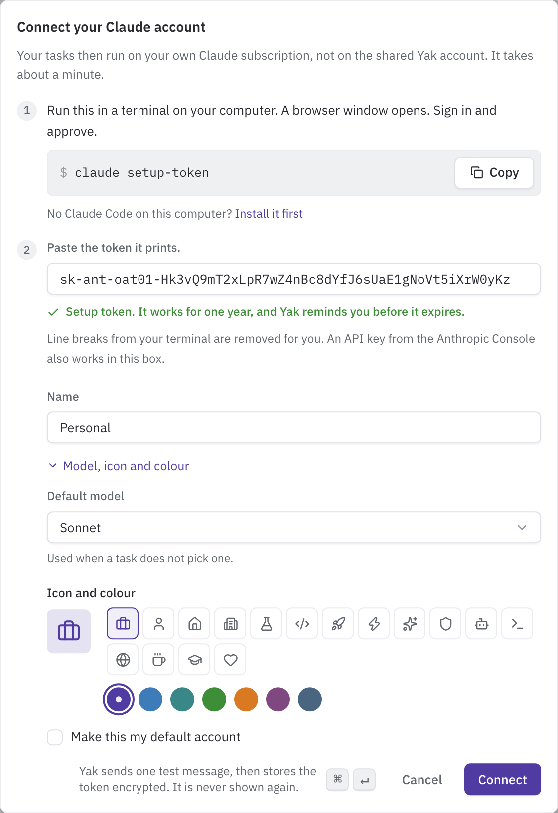

# Claude accounts

A Claude account is the credential Yak uses to talk to Claude. Every thread runs on exactly one account, for its whole life. Add your own account so your work counts against your plan, and read this page when a thread shows "Usage limit reached" or "Token problem".

Yak opens pull requests for human review and serves previews. It never merges and never deploys, whichever account it runs on.

## Your accounts and Yak accounts

There are two kinds of account owner.

| | Your account | Yak account |
|---|---|---|
| Who can add it | Anyone who signs in to Yak | Yak admins only |
| Who can use it | Only you | Everyone, when they pick it on the new thread page |
| Who replaces or removes it | You | Yak admins |
| Used for | Threads you start | Work nobody started (Sentry alerts, Linear automation, flaky tests) and people with no account of their own |

Admins manage the Yak accounts (see [Admins](#admins)). Anyone else sees the Yak accounts section with an "Admins only" badge and can read it but not change it.

There are two secret types:

- **Setup token**: uses your Claude subscription. Run `claude setup-token` on your own computer and copy the token it prints. Usage counts against your plan.
- **API key**: a key from the Anthropic Console. Anthropic bills each turn as it runs. Yak sets no spending cap on API keys, so set limits in the Anthropic Console.

## Add an account

1. On your own computer, run `claude setup-token` and copy the token it prints. For an API key, copy the key from the Anthropic Console.
2. Open Settings > Claude accounts and choose **Add account**. (Yak admins use **Add Yak account** in the Yak accounts section.)
3. Paste the secret into the one box. It takes a setup token or an API key, and Yak detects which one it is. Line breaks and spaces from your terminal are removed for you.
4. Give the account a name and choose **Connect**.
5. Optionally open **Model, icon and colour** before you connect (table below).

| Field | What it does |
|---|---|
| Paste the token it prints. | The secret. Yak shows whether it is a setup token or an API key, and never shows the secret again, not even to you. |
| Name | How you tell accounts apart, for example "Personal" or "Acme work". Setup tokens carry no email or organization, so the name is the only label. For a Yak account, everyone who can use it sees the name. |
| Default model | `opus`, `sonnet` or `haiku`. Used when nothing more specific picks a model. Under **Model, icon and colour**. |
| Make this my default account | Your default for every repository without its own setting. It is ticked when you have no default yet. Not shown for Yak accounts. Under **Model, icon and colour**. |
| Icon and color | Shown next to the account in the thread list and in pickers. Under **Model, icon and colour**. Change them later under the account's menu, **Edit name and appearance**. |

When the account is connected, the dialog confirms it and offers to set up [Teleport](teleport.md) if you have no paired computer yet.

### The shared Yak account

Admins add the shared Yak account the same way, from Settings > Claude accounts > **Add Yak account** (a new install also shows it in the setup bar). The first usable Yak account you add becomes the default for unattended work.

Use a Claude seat that belongs to the team, not your personal one. `claude setup-token` only prints a token and leaves your own Claude login alone, but its sign-in page uses your browser's current Claude session. Copy the page's address into a private browser window and sign in to the team seat there. To run the command on the Yak server instead, see [Setup](setup.md#first-sign-in).

Before saving, Yak checks the secret with a one-word test message on Haiku ("Sending a one-word test message on Haiku..."). If Claude rejects it, nothing is saved and the dialog shows the reason. A setup token is marked to expire one year after you add it. The **Secret expires** column shows the date. Yak sets no spending cap on an API key.

## Which account a thread uses

When a thread starts, Yak uses the first of these that applies:

1. The account you pick under **Runs on** on the new thread page. It must be yours or a Yak account.
2. The account you set for that repository under "Your Claude account for this repo" on the repository's page.
3. Your default account.
4. The repository's unattended account.
5. The global Yak account (the Yak account marked as the default).

Yak skips any account that is not usable (invalid, expired) and never uses another person's account. Threads that nobody started, such as Sentry alerts and flaky tests, begin at step 4. A thread started from Slack, Linear or email uses the account of the person who started it.

The account is fixed for the life of the thread. Every turn runs on it, including turns sent by other people. This keeps Claude's prompt cache warm and means a teammate cannot spend your plan on a thread you did not start. To continue on a different account, start a new thread.

If no account resolves at all, the task fails with "No Claude account is available. Ask an admin to add a Yak system account."

### Model

The model follows a similar order:

1. The model you pick on the new thread page.
2. The model you set for that repository, when the thread runs on the account you set for that repository.
3. The account's default model.
4. `YAK_DEFAULT_MODEL` (default `opus`).

### Per repository and unattended work

On a repository's page, "Your Claude account for this repo" sets your own account and model for that repository. Only you see and use it. The Unattended account section sets the Yak account that runs work nobody started. Only admins change it, and when it is unset the global Yak account is used. See [Repositories](repositories.md).

## Turn limit per account

Each account runs at most 1 to 64 turns at once (default 16). To change it for one account, open its menu, choose **Edit name and appearance** and set **Concurrent turns**.

A turn that arrives when the account is full waits. The thread shows **Waiting for the account** with your place in line ("You are number 2 in line"). Your message is saved, nothing needs doing, and the turn starts when a slot frees up.

## Usage limits

Claude can reject a request in two ways, and Yak treats them differently:

- A **usage limit** (HTTP 429 with the `usage_limit_reached` error) means the account has used its plan or quota for now. Yak blocks the thread.
- A **short rate limit** (a 429 without that error) is a brief slowdown. Yak does not block anything and the turn carries on.

When an account hits a usage limit:

1. Yak interrupts the running turn. It ends as failed and is not replayed.
2. The thread shows the notice **Usage limit reached** and the status **Token problem**, with the reset time ("Resets at 3:40 PM, in 41 minutes"). Yak uses the reset time Claude reports. If Claude reports none, Yak assumes `YAK_THREADS_USAGE_LIMIT_FALLBACK_MINUTES` minutes (default 60) from the hit.
3. Every thread on that account is blocked, not only the one that hit the limit.
4. Yak tells people:
   - The account owner gets a push notification, an email and, if Slack direct messages are on, a Slack direct message: `Claude account "Personal" hit its usage limit. It resets in 41 minutes.` For a Yak account, the admins get it.
   - The person who last drove the thread gets the same message, and a "Needs you" push for the thread (see [Notifications](notifications.md)).
   - Yak sends each of these once per account (and once per driver) per episode of up to six hours, however many threads are blocked.
5. You can wait, or choose **Start a new thread on another account** in the notice.

When the reset time passes, Yak lifts the block on every thread of that account. The turn that hit the limit does not start again by itself. What happens next depends on what is waiting:

- A message you sent while the thread was blocked is saved. Yak starts it after the block lifts, so Claude reads it after the reset.
- A task from a channel (Slack, Linear, Sentry, email, GitHub) that tries to start on a blocked account is held and tried again every five minutes until the block lifts.
- If nothing is waiting, send a message in the thread to continue.

## Invalid and expired tokens

If Claude rejects the token (HTTP 401), Yak marks the account **Needs a new secret**, blocks its threads and tells the owner. Threads show **Token problem**. The owner sees "Your token stopped working" and a link to Settings > Claude accounts. Everyone else on the thread sees "<Owner>'s token stopped working" and can start a new thread on their own account. Yak never falls back to another account, because that would quietly bill someone else.

When a setup token reaches its expiry date, Yak marks the account **Expired** and the thread shows "Your token has expired". Yak warns the owner once, 14 days before the date (Slack direct message and email, "Claude account ... expires soon. Replace its token before it stops working"), and the account row shows an "Expires in N days" badge.

To fix either problem, open the account and choose **Replace secret** (see below). When the new secret passes the check, Yak lifts the token block on the account's threads right away.

## Block reasons

A blocked thread shows one notice above the message box. These are the reasons that relate to accounts and capacity:

| Status pill | Notice | Meaning | What to do |
|---|---|---|---|
| Token problem | Usage limit reached | The account hit a usage limit. | Wait for the reset time, or start a new thread on another account. |
| Token problem | Your token stopped working / Your token has expired | Claude rejected the token, or it passed its expiry date. | Replace the secret under Settings > Claude accounts. |
| Token problem | "<Owner>'s token stopped working" / "has expired" | The same, on someone else's account. | Ask the owner to replace it, or start a new thread on your own account. |
| Waiting for the account | Waiting for the account | The account already runs its maximum number of turns. | Nothing. The turn starts when a slot frees up. |
| Waiting for a sandbox | Waiting for a free sandbox | All sandbox slots are in use. | Nothing, or stop another thread. See [Threads](threads.md). |
| Token problem | A credential was exposed | A secret appeared where it should not, so Yak stopped the thread. | Replace the secret and ask an admin to check the thread. |
| Rebuild failed | Rebuilding the sandbox stopped | The sandbox could not be restored. | Retry from the notice. See [Threads](threads.md). |

## Budgets and the runaway guard

Two older budget settings still exist. They apply to Yak's own cost checks, not to the usage of your Claude account:

| Setting | Default | What it gates |
|---|---|---|
| `YAK_DAILY_BUDGET_USD` | 50 | Before a task starts a run, a retry, a research run or a follow-up from a channel, Yak compares the cost recorded for today (see Costs in [Dashboard pages](dashboard.md)) with this limit. At or over it, the job fails with "Daily budget of $50.00 exceeded". It never stops a turn that is already running. |
| `YAK_MAX_BUDGET_PER_TASK` | 5 | A cost cap, in US dollars, for one repository setup run or one PR review run. Thread turns do not use it. |

To stop a single thread turn that runs too long, Yak has a separate runaway guard based on steps and time. See [Threads](threads.md).

## How your token stays safe

The agent in a sandbox has full control of that sandbox, so Yak never puts your real token there.

- Your token stays on the Yak host, stored encrypted.
- Each running thread gets a random stand-in. It works only from that thread's own sandbox, only for requests to Claude's message API, and only while the thread is alive.
- A small proxy on the host swaps the stand-in for the real token on each request.

## Teleported threads

When you teleport a thread to your computer, Yak runs no turns on it. Turns you run there use your local Claude login, not the thread's Claude account. When you teleport it back, the thread keeps its account (or gets one by the order above if it had none). See [Teleport](teleport.md).

## Rotate and remove

- **Replace secret**: open the account, choose **Replace secret** and paste a new one. Yak checks it the same way as when you add it. If the check fails, the old secret stays.
- **Remove account**: open the account's menu and choose **Remove account**. The secret is deleted and cannot be recovered. Resting runners on it end. Threads keep their history, are blocked, and their owner starts a new thread on another account to continue. Repositories that used a removed Yak account fall back to the global Yak account.

Only the owner of an account can replace or remove it. Admins manage the Yak accounts. Admins also see an **Awake share** card on this page with how many sandboxes each person has awake.

## Admins

The first person to sign in to a new Yak is its admin. Admins manage the Yak accounts. They also promote or demote other people in Settings > People, which only admins can open. A role change applies at once. Nobody can change their own role, and an admin who comes from the server config shows as "Set in server config" and cannot be changed there.

`YAK_SYSTEM_ACCOUNT_ADMIN_IDS` is an optional server setting. It takes a comma-separated list of user ids that count as admins whatever the stored role says. When it is set, the first person to sign in is not made an admin automatically.
