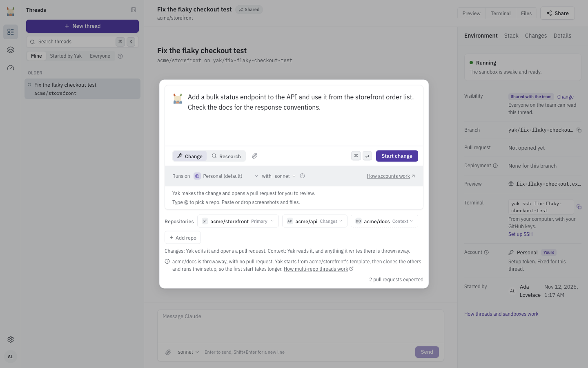
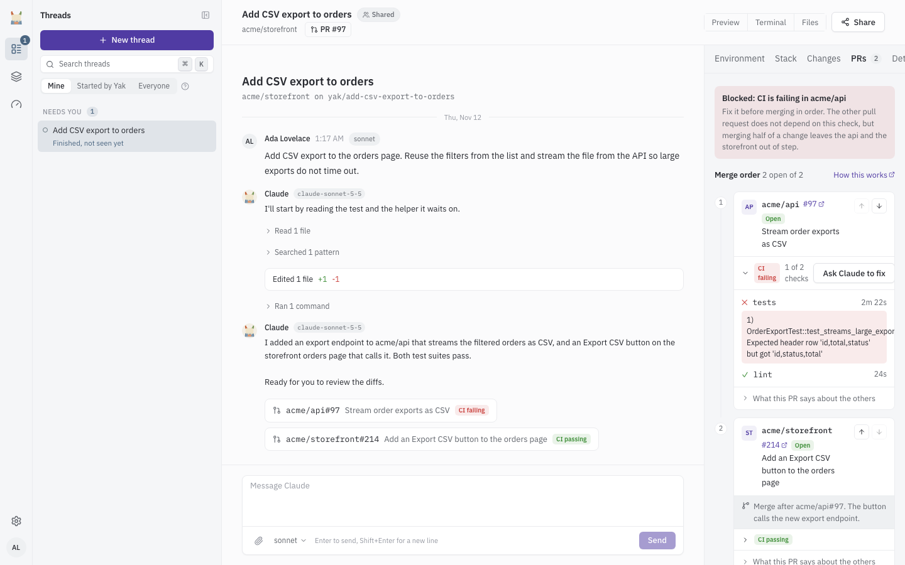
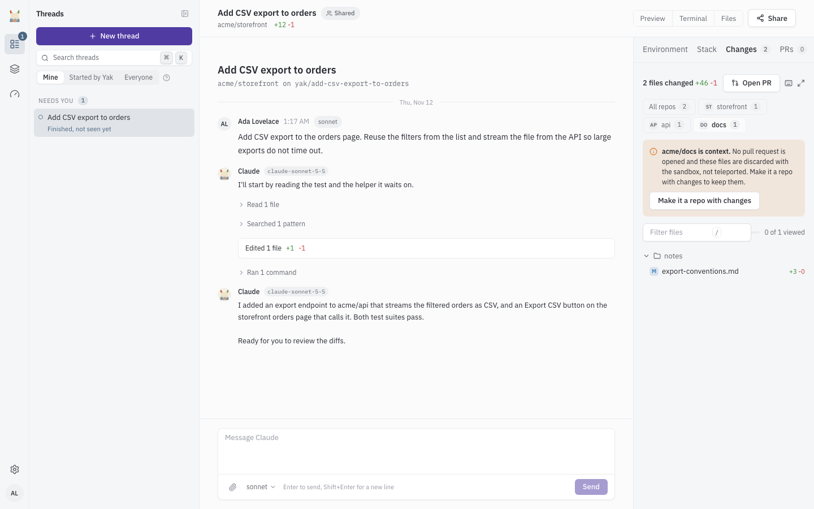

# Multi-repo threads

A multi-repo thread works in several repositories inside one sandbox and opens one pull request in each repository that changes. Use one when a single piece of work spans repositories, for example an API change in `acme/api` and the matching client change in `acme/storefront`.

This is different from repository routing, where Yak picks the one repository for an incoming task. See [Repositories](repositories.md) for that.

## Choose repositories when you start a thread

On the new thread form, the repository picker shows one chip for the primary repository and one chip per extra repository.

1. Pick the primary repository. Its chip shows "Primary" and has no role menu. The sandbox starts from this repository's template, and it lives at `/workspace`.
2. Select "Add repo" and pick another repository. Yak checks access first ("Checking access to ...").
3. Open the role menu on the new chip and choose a role.

| Role | Meaning |
|---|---|
| Changes | Yak edits it and opens a pull request. |
| Context | Yak reads it. Anything it writes there is thrown away with the sandbox. |

In research mode every extra repository is Context, and the role menu is replaced by a fixed "Context" label.

A thread can use up to 6 repositories, the primary one included. At the limit the picker shows "6 of 6 repos".

Yak must be able to reach every repository through its GitHub App. If it cannot, the picker shows "Yak cannot reach acme/docs" with the reason, and you can remove the repository from the thread before you start.

After you start the thread, the page shows each repository as Queued, Cloning, Running setup, Ready or Setup failed. The first start takes longer with several repositories.

## Where the repositories live in the sandbox

The primary repository is at `/workspace`. Every extra repository is cloned to `/extras/<name>`, for example `/extras/api`. If two repositories share a name, the second uses `/extras/<owner>-<name>`. Claude works across them by absolute path.

## Claude adds a repository during a thread

Claude can add a repository when it finds it needs one, with a role of Changes or Context and a short reason. The conversation shows a card for it ("Adding a repository", then "Added a repository").

Yak adds a repository only if two things hold: the repository is active in Yak, and the Yak GitHub App installation can read it. If either fails, nothing is cloned and the card reads "Could not add a repository" with "Yak cannot clone acme/docs". The card offers "Open repository settings" and "How Yak gets access". Give the GitHub App access to the repository, then ask Claude to add it again.

## Setup status and Retry

Each extra repository runs the same setup as a primary one. The Environment panel lists every repository with its role, its path in the sandbox, and its status. If setup fails, the repository stays cloned and Claude can read it, but builds and tests there may fail until dependencies are installed. The failed row offers three actions:

- "Retry setup" runs setup again.
- "Make it context only" turns a Changes repository into Context. This is offered only while it has no open pull request. Otherwise the panel says "Close its pull request to make it context only."
- "Remove" takes the repository out of the thread (not offered for the primary repository).

## Pull requests

When Claude finishes, Yak opens one pull request in each Changes repository that changed. The pull requests link to each other and list the order to merge them in. Context repositories never get a pull request. Yak never merges: you review and merge each one yourself.

The PRs panel appears when a thread has more than one repository or more than one pull request. For each pull request it shows:

- The repository, pull request number, and state (Open, Merged or Closed).
- A CI badge (CI passing, CI failing or CI running) with a passed-over-total count. Expand it to see each check, and the output excerpt for a failing one.
- "Ask Claude to fix", shown when CI is failing. It sends Claude the failure to work on.
- A line such as "Merge after acme/api#41" when one pull request depends on another.

Pull requests are listed under "Merge order". The order is a suggestion: Claude sets it, and if you can drive the thread you can move a pull request earlier or later with the arrow buttons. Yak does not enforce it.

Repositories with no pull request (for example Context repositories) are listed under the pull requests with a note.

### CI retries

Each repository has its own CI retry budget. When CI fails on one repository's pull request, Yak sends the failure back to Claude to fix, up to `YAK_MAX_ATTEMPTS` times (default 2). A repository that has used its retries does not use another repository's. When the retries run out, Yak notifies you that CI is still failing.

## The Changes panel

The Changes panel has a tab row: "All repos" with the total file count, then one tab per repository. A Context repository's tab is dashed. Its tab explains that no pull request is opened and the files are discarded with the sandbox, and offers to make it a Changes repository so the edits are kept.

## Previews

A thread preview uses the primary repository only. Extra repositories do not contribute a `.yak/preview.yml`. See [Previews](previews.md#thread-previews).
