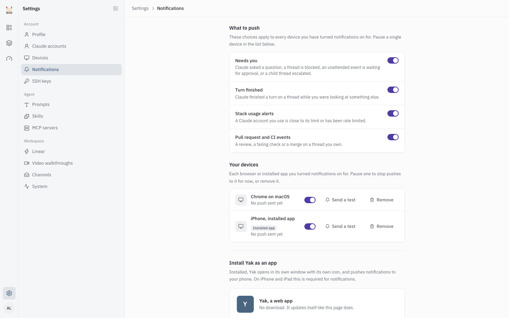

# Notifications

Yak reaches you through push notifications on your phone or computer, Slack direct messages, and email. Use this page to turn push on, choose what it covers, and see who hears about what.

## Push notifications

Push works on any browser or installed web app you turn it on for. Each of those is a "device" on the Notifications page. This is separate from the paired computers on the Devices page (see [Teleport](teleport.md)).

### Turn push on

1. Open Settings > Notifications.
2. Optional: install Yak as an app. The "Install Yak as an app" section at the bottom of the page shows how. Installed, Yak opens in its own window with its own icon.
3. Choose **Turn on for this device**. Your browser asks for permission. Allow it.

If the page shows "Push is not set up on this server", the server has no VAPID keys. Ask whoever runs Yak to set them up. See [Setup](setup.md).

### iPhone and iPad

Safari tabs cannot receive push on iOS. Add Yak to your Home Screen and open it from the icon:

1. Open Yak in Safari (other iOS browsers cannot add web apps) and tap Share.
2. Tap **Add to Home Screen** and then **Add**.
3. Open Yak from the Home Screen icon, go to Settings > Notifications and choose **Turn on for this device**.

This needs iOS 16.4 or later. If the button does not appear, check that notifications are allowed for Yak in iOS Settings.

### What to push

Four switches apply to every device you turned push on for. All start on.

| Toggle | You get a push when | Sent to |
|---|---|---|
| Needs you | Claude asks you a question; a thread is blocked by a usage limit, an exposed credential or a failed sandbox rebuild; a turn fails; a turn is stopped by the runaway guard; an event waits for you on a thread that is on a paired computer; a sub-thread escalates to its parent | The person who last drove the thread. Blocks also go to the thread's owner. Waiting events go to the owner. |
| Turn finished | Claude finishes a turn | The person who started that turn |
| Stack usage alerts | A stack of threads crosses a usage mark: every 50 turns, every 3 hours of activity or every 12 sub-threads (defaults) | The owner of the stack |
| Pull request and CI events | Yak opens a pull request, or CI fails or passes on it | The thread's owner |

Yak skips a push when you have that thread open at the moment, and for a thread you cannot see. A private thread's push says only "Private thread. Open Yak to read it." A usage limit, an invalid token or an expiring token on one of your Claude accounts also pushes to you, regardless of these toggles (see [Claude accounts](claude-accounts.md)).

### Your devices

The "Your devices" list shows every browser or installed app you turned push on for.

- **Pause**: the switch on a device stops pushes to it without removing it.
- **Send a test**: sends a test push to that device. The row shows "Test sent" or "Test failed".
- **Remove**: forgets the device. Turn push on again from that browser to add it back.

If a device's last push failed, the row says so.

## Slack and email

- **Slack direct messages**: a switch on your Profile page. When on, Yak messages you in Slack when a task you started needs an answer, has a PR ready or failed. It applies to tasks that start from Linear, the dashboard, email and automation. Slack tasks reach you through the Slack thread, and GitHub tasks through the pull request. Mentions in Slack threads are not affected. Account problems (usage limit, invalid or expiring token) also use this switch for the Slack message.
- **Email**: account problems and events waiting on a paired computer also arrive by email at your sign-in address.
- **Extra email addresses**: the "Email to Yak" card on your Profile page lists the addresses Yak accepts forwarded email from. Add an address and confirm it from the email Yak sends there. These addresses start tasks. They do not receive notifications. See [Channels](channels.md).

## Who is told

| Event | Who |
|---|---|
| A question from Claude | The person who last drove the thread |
| A turn finishes or fails | The person who started the turn |
| A thread is blocked (usage limit, exposed credential, failed rebuild) | The last driver and the owner |
| Usage limit on an account | The account's owner (admins for a Yak account) and the last driver |
| Invalid, expired or expiring token | The account's owner |
| Pull request opened, CI result | The thread's owner |
| Stack usage mark | The stack's owner |

## Needs you in the sidebar

The Threads sidebar has a "Needs you" group at the top and a badge on the Threads icon with its count. A thread is there when Claude asked you a question, when it is blocked ("Your token stopped working" or "Blocked"), or when a turn finished and you have not looked at it yet ("Finished, not seen yet"). See [Threads](threads.md).
