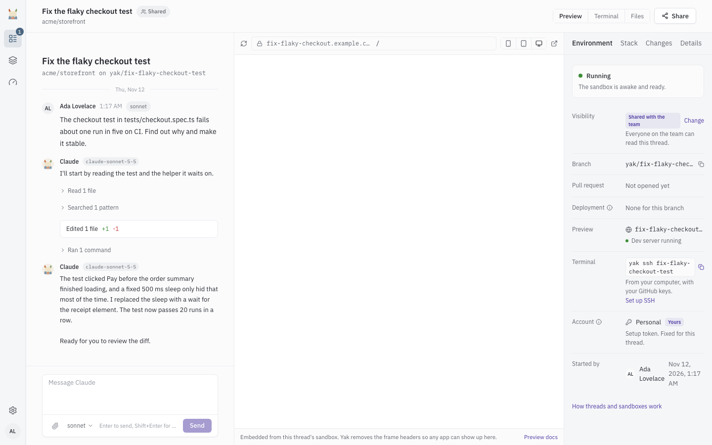

# Previews

A preview is a running copy of the app that you open in a browser to see what Claude changed. Yak serves previews so you can review work without checking out a branch. It does not deploy to production.

Yak has two kinds of preview.

| | Thread preview | Branch deployment |
|---|---|---|
| Runs in | The thread's own sandbox | A separate container per pull request branch |
| Shows | The work as it happens, before any pull request exists | The branch of an open pull request |
| Where you open it | The Preview panel on the thread page | The "View deployment" button on the pull request, or the Deployments page |
| Enabled by | `.yak/preview.yml` in the primary repository | The "Branch deployments" setting on the repository |
| Address | `t-<random>.<host>` | `<repo>-<branch>.<host>` |
| Wakes on | Opening the panel or the address | The first request |

## Thread previews

A thread preview runs the app's dev server inside the thread's own sandbox, so it shows Claude's uncommitted work as it happens.

### Requirements

The primary repository needs a `.yak/preview.yml` that says which port the app listens on, how to start it (`cold_start`) and which path answers when it is ready (`health_probe_path`). See [Repository config](repo-config.md#previewyml) for every key. Only the primary repository is read. Extra repositories of a [multi-repo thread](multi-repo.md) do not contribute.

If the file is missing, the panel says "Tell Yak how to run this app" with a sample file and an "Ask Claude to add it" button. If the file has errors, the panel says "The preview file is not valid" and shows what is wrong.

### Open the preview

Select Preview in the thread header. The panel is an embedded view of the app with a toolbar:

- A path field, to open another page of the app.
- A reload button and an "Open in a new tab" button.
- A width switch: "Phone width, 390 px", "Tablet width, 768 px" and "Full width". The switch is hidden on small screens.

When a thread has Implement or Mockup sub-threads with a sandbox, the panel shows a tab for each, so you can preview the sub-thread's own work. See [Sub-threads](sub-threads.md).

### Waking a preview

A preview wakes when you open it. Yak holds the request for up to 10 seconds (`YAK_THREADS_PREVIEW_HOLD_SECONDS`). If the preview is still not ready, the panel shows the steps and opens the app on its own once it answers, so you can leave the tab.

1. Wake the sandbox. Shown when the sandbox was paused to save capacity.
2. Start the dev server. Yak runs the `cold_start` command.
3. Wait for the app to answer on the manifest's port.

A sandbox woken for a preview counts toward the awake limit (8 host-wide, 4 per person by default). If your slots are all in use, the panel says "Waiting for a free sandbox" and starts as soon as one frees up.

| Panel shows | Meaning | What to do |
|---|---|---|
| Waking your preview | The sandbox is waking. | Wait. |
| Starting the dev server | `cold_start` is running. | Wait. The panel shows the dev server output. |
| Waiting for a free sandbox | You are at your awake sandbox limit. | Wait, or stop another thread. |
| The app did not answer | The dev server started but the app did not answer on its port. | "Try again", "Ask Claude to fix it", or "Edit .yak/preview.yml". |
| The sandbox was removed | The sandbox was destroyed after a long time without use. | "Restore preview", if you can drive the thread. |
| This thread is closed | Closed threads do not run a preview. | Start a new thread. |
| This thread runs on your computer | The work and dev server are on your computer. | Run the app there, or [teleport](teleport.md) the thread back to Yak. |

### Safari

Desktop Safari blocks the sign-in that a preview needs inside a frame. The panel shows "Open the preview in a new tab" instead, and the preview works the same in its own tab. iOS Safari shows the frame. Operators can turn the fallback off with `YAK_THREADS_PREVIEW_SAFARI_FALLBACK`.

### Timeouts

Traffic to a preview keeps its sandbox awake. A sandbox that had a preview request in the last 5 minutes (`YAK_THREADS_PREVIEW_ACTIVITY_MINUTES`) is not paused for being idle. After that the normal idle pause applies. See [Threads](threads.md).

## Branch deployments

A branch deployment is a container Yak runs for the branch of an open pull request, so a reviewer can click through the change. Turn it on per repository with the "Branch deployments" setting on the repository page.

### What you get

- A unique address per branch, `<repo>-<branch>.<host>`.
- An isolated container per branch, with its own database and files.
- A "Deployments" entry on the pull request with a "View deployment" button.
- An update on every push to the branch.
- A teardown when the pull request closes or merges, or the branch is deleted.

### Lifecycle

1. A pull request opens on a repository with branch deployments on.
2. Yak creates a container from the repository's template snapshot and checks out the pull request head.
3. A reviewer opens the preview. If it is idle, the request is held for a few seconds while the container wakes.
4. Each push updates the preview in place. If the container is hibernated, the preview is marked to refresh on its next wake. A push to a failed preview rebuilds it from the template at the new commit.
5. After 15 minutes without traffic the container hibernates (`YAK_DEPLOYMENTS_IDLE_MINUTES`). The next request wakes it.
6. A preview nobody has opened for 7 days is destroyed (`YAK_DEPLOYMENTS_DESTROY_DAYS`), whatever state the pull request is in.

How long the first request takes: a new deployment up to about 2 minutes, a warm one under a second, a hibernated one 5 to 15 seconds. A loading page shows while a slow boot finishes.

### Long-lived branches

A branch whose name contains `release/` is long-lived (`YAK_DEPLOYMENTS_RELEASE_BRANCH_PREFIX`). It hibernates after 3 days of inactivity instead of 15 minutes (`YAK_DEPLOYMENTS_LONG_LIVED_IDLE_MINUTES`, 4320) and is not destroyed by the 7-day idle sweep.

You can change this per deployment in the Hibernation card on the deployment page. Turn on "Keep this branch long-lived" and set a "Hibernation timeout" such as `3d`, `12h` or `2w`.

### Where the recipe comes from

The recipe that starts and refreshes a preview lives in `.yak/preview.yml` on the repository's default branch. That file is the source of truth. The "Branch deployments" section of the repository settings is a form that applies only while the repository has no `.yak/preview.yml`. Once the file exists, the form shows it read-only. See [Repository config](repo-config.md#previewyml) for the keys.

Every branch uses the default branch's recipe, so a fix to it reaches all branches once it merges. One exception: a pull request that changes `.yak/preview.yml` itself previews with its own copy, so a change to the recipe proves itself before it merges. If that copy is missing, invalid or unreadable, the default branch's recipe is used.

### Idle hibernation and the running limit

Yak runs at most 6 deployments at once (`YAK_DEPLOYMENTS_RUNNING_CAP`). Hibernated deployments only use disk. When someone opens a hibernated preview:

1. If a slot is free, it starts.
2. If Yak is at the limit, it stops the deployment that was used least recently, provided that one has been idle for at least 5 minutes (`YAK_DEPLOYMENTS_EVICTION_GRACE_MINUTES`).
3. If every running deployment was used in the last 5 minutes, the request gets a "server at capacity" response.

### Activity log

Each deployment's page has a timestamped activity log. Every command Yak runs in the container (fetch, checkout, refresh, cold start) and every state change gets an entry with its output and exit code. When a push fails to refresh, start there.

### Troubleshooting

**"Preview unavailable" appears.** The deployment failed to boot. Open its page in Deployments to see the failure reason and the phase that stalled (`cold_start`, `checkout_refresh` or `health_probe`). Common causes: a broken `cold_start` command, migrations that fail on the branch, or a health probe path that returns 404 on the new code.

**The template is stale after a dependency update.** Use "Rebuild from latest template" on the deployment page, or "Rebuild all deployments" on the repository page. A rebuild resets the container's database and files.

## Preview repair

When a branch deployment fails, Yak looks into the cause instead of leaving you with a "Preview unavailable" page. This works for repositories with branch deployments on. It is controlled by "Investigate failed previews" in the repository settings, which is on by default.

1. A failed preview starts an investigation. Previews that fail for the same cause share one investigation, and a preview already investigated at the same commit is not investigated again.
2. Claude works out the cause. If the shared recipe on the default branch is at fault, it opens a pull request that fixes it. If the cause is in the branch, no pull request is opened.
3. Yak tells the pull request author on Slack (or the repository's default responsible person, when the author is unknown). A person with several failed previews gets one message. People who turned off Slack direct messages are skipped. A summary also goes to the Yak feed channel.
4. When the repair pull request merges, Yak rebuilds the previews that are still failing and tells the author.
5. While the repair pull request stays open and more previews fail from the same cause, Yak sends a reminder after 3 days.

Yak starts at most 3 investigations per repository per day. After that it posts once that investigations are paused and picks up new failures the next day. The preview of a repair branch that fails does not start another investigation.

## Sharing a preview

Who can open a preview depends on the kind.

Both kinds sit on their own host, and the dashboard session does not reach it. Instead, when you open a preview signed in to Yak, Yak gives your browser a single-use ticket for that one host, valid for 60 seconds. The preview host swaps it for a cookie that works for that host only and lasts 8 hours. After that you can click around without signing in again. When the cookie expires, you are sent back through sign-in and returned to the preview. Nobody else can reuse the ticket or the cookie.

- A thread preview opens for anyone who can see the thread. For a private thread that is the owner and the people it is shared with. The thread must be open and must run on Yak, not on a computer. See [Threads](threads.md) for visibility.
- A branch deployment opens for any signed-in Yak user. When the deployment belongs to a thread, the thread's visibility applies.

### Share links for branch deployments

To show a branch deployment to someone who is not a Yak user, create a public share link.

1. Open the deployment in Deployments.
2. In "Public share link", set "Expires in (days)" (default 7, maximum 30) and select "Generate share link".
3. Copy the link. It is shown once.

Anyone with the link can open the preview without signing in, until it expires. The first visit sets a cookie, so navigation inside the app keeps working. Treat the link as a secret. Select "Revoke" to invalidate it early.

Share links do not open a deployment that belongs to a private thread. Thread previews have no share link.
