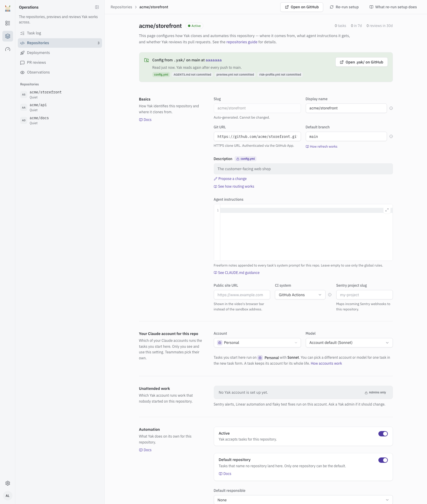

# Repositories

A repository is a codebase Yak can work in. This page covers how to add one, what setup does, how an incoming task is routed to a repository, and what each setting on the repository page does. Settings that can also live in the repository itself are in [Repository config](repo-config.md).

## Adding A Repository

1. Open **Repositories** and choose **Add repository** (`/repos/create`).
2. Under **GitHub repository**, search your GitHub repositories and pick one. Yak fills in the display name, description, Git URL and default branch, and guesses the CI system and Sentry project.
3. Adjust the fields under **Basics**, **Automation** and the other sections (see [The repository page](#the-repository-page)).
4. Choose **Add repository**. Yak dispatches a setup task (see [The Setup Task](#the-setup-task)).

The repository must be reachable by the GitHub App installation. Yak clones over HTTPS with the App's token.

At most one repository is the default. Marking a repository as default clears the flag on the others. The slug is generated from the repository name, is unique, and never changes, even if the repository is renamed on GitHub.

## The Repository Page

Open a repository from the **Repositories** list. The list shows each repository's slug, name, CI system, setup status, base version, active state, default flag, task counts (total and last 7 days) and whether PR review is on.



The page shows a strip at the top about `.yak/` config. A field that a `.yak/` file sets shows the file value read-only with a badge naming the file, and a **Propose a change** link where the file can be edited on GitHub. Saving the page never writes a locked field. See [Repository config](repo-config.md#where-config-comes-from).

| Section | Field | What it does |
|---|---|---|
| Basics | Slug | Read-only. Yak's internal identity for the repository. |
| Basics | GitHub repository | Shown only if the repository was renamed on GitHub. Read-only. |
| Basics | Display name | Name shown in the dashboard and task lists. |
| Basics | Git URL | HTTPS clone URL. |
| Basics | Default branch | The branch Yak bases work on and opens pull requests against. |
| Basics | Description | One line on what the repository does. Yak uses it to route natural-language tasks. Locked by `description` in `.yak/config.yml`. |
| Basics | Agent instructions | Notes added to Claude's instructions for this repository. Locked by `.yak/AGENTS.md`. |
| Basics | Public site URL | Shown in the browser bar of walkthrough videos. Locked by `walkthrough.public_site_url`. |
| Basics | CI system | None, GitHub Actions or Drone. Where Yak reads CI results after it pushes a branch. Locked by `ci`. |
| Basics | Sentry project | Maps incoming Sentry alerts for that project to this repository. A dropdown when the Sentry integration can list projects, otherwise **Sentry project slug**. |
| Your Claude account for this repo | Account, Model | Your own account and model for this repository. See [Claude accounts](claude-accounts.md). |
| Unattended work | Yak account | The Yak account that runs work nobody started. Admins change it, everyone else sees it. |
| Automation | Active | Whether Yak accepts tasks for this repository. |
| Automation | Default repository | Tasks that name no repository can land here. |
| Automation | Default responsible | The person who owns tasks that nobody started, such as Sentry alerts and CI scans. |
| Automation | PR review | Yak reviews every open, non-draft pull request. Locked by `review.enabled`. See [PR review](pr-review.md). |
| Automation | Review all currently open PRs on save | Appears when you switch PR review on. Queues a review for each open, non-draft pull request when you save. |
| Automation | Re-review all open PRs | Button that queues those reviews again. |
| Automation | PR review path filters | Globs Yak leaves out of reviews. Locked by `review.exclude_paths`. |
| Automation | Risk-based approval | Approval mode, paths, checks and limits. See [PR review](pr-review.md#risk-based-approval-opt-in). Locked field by field by `review.approval`. |
| Automation | Co-owner gate | Status only: whether the gate is on, and whether owners can be asked. The mode is set in `.yak/config.yml`. See [Repository config](repo-config.md#the-co-owner-gate). |
| Automation | Branch deployments | Serve a preview for every open PR branch. See [Previews](previews.md#branch-deployments). |
| Automation | Investigate failed previews | Appears when branch deployments are on. When a preview fails, Yak looks into it, opens a repair pull request if the shared preview setup is broken, and tells the PR author. See [Previews](previews.md#preview-repair). |
| Branch deployments | Port, Health probe path, Cold start command, Checkout refresh command, Wake timeout (seconds) | The preview recipe stored in Yak. A value from `.yak/preview.yml` locks its field, and a committed `.yak/preview.sh` replaces the checkout refresh command. See [Repository config](repo-config.md#previewyml). |
| Sandbox template | Snapshot, yak-base version | The snapshot new sandboxes start from. A warning badge shows when a newer base version is available. |
| Setup history | | The repository's setup tasks, with status, start time and duration. |
| Danger zone | Deactivate or Activate, Delete | Deactivating keeps history and stops new tasks. Delete is only possible for a repository with no tasks. |

Choose **Save repository** to store changes. The page menu has **Re-run setup**, and **Open on GitHub** is in the header.

### Open a config PR

A repository that was added before it had a `.yak/` directory shows "Settings are stored in Yak, not in the repository". Choose **Open a config PR** to open a pull request that moves today's settings into `.yak/`. A repository whose setup has not finished shows **Run setup** instead, because setup opens that PR itself. See [Repository config](repo-config.md#migrating-an-existing-repository).

### Datasets

A repository can declare a large dataset in `.yak/config.yml` that Yak clones into its sandboxes. See [Repository config](repo-config.md#datasets).

## The Setup Task

When you add a repository, Yak dispatches a setup task: a one-shot Claude run that is not a thread. It runs on the repository's unattended account (see [Claude accounts](claude-accounts.md)).

### What It Does

1. Reads `README.md`, `CLAUDE.md`, `docker-compose.yml` and other config files.
2. Sets up the dev environment: starts services, installs dependencies, runs migrations and seeders.
3. Verifies it works by starting the dev server and running the test suite.
4. Opens a pull request that adds `.yak/config.yml` and `.yak/preview.yml`, if neither exists. Settings apply once the PR merges.

### Sandbox Template

When setup succeeds, the setup sandbox is snapshotted and becomes the repository's **sandbox template**. Every thread gets its own sandbox, started from this template in about two seconds. The template already has Docker images pulled, dependencies installed and the database migrated. Changes in one thread's sandbox never reach another. Repositories added to a thread later ([multi-repo threads](multi-repo.md)) are cloned into the sandbox and do not use a template.

Two things rebuild a template. A newer `yak-base` version (shown as a **Base** badge on the list and the sandbox section) re-provisions it on the next run. A changed `.yak/setup.sh` on the default branch discards it, and Yak runs a fresh setup before the next task starts.

### Setup Status

| Status | Meaning |
|---|---|
| `pending` | The repository was added but setup has not started. |
| `running` | The setup task is executing. |
| `ready` | Setup succeeded. The repository accepts tasks. |
| `failed` | Setup failed. Open the task under **Setup history** for the log. |

### Re-running Setup

If the dev environment breaks (new Docker services, changed migrations, new dependencies), re-run setup:

- **Dashboard:** open the repository page menu and choose **Re-run setup**.
- **Command line:** `docker exec yak php artisan yak:setup-repo my-app`

Re-running setup builds a fresh environment and replaces the template.

## Routing Tasks To Repos

A task that arrives through a channel names no repository field, so Yak works one out. It stops at the first rule that matches. Only active repositories are considered.

1. **Explicit mention**: `@yak in my-cli: ...`, `--repo=my-cli` or `repo: my-cli`.
2. **Several repositories named**: if the text names more than one active repository slug, Slack and email create one task per repository, and each task runs in its own thread.
3. **Sentry project**: the `sentry_project` of a repository matches the alert's project.
4. **One active repository**: it is the answer.
5. **The router**: when an Anthropic API key is configured on the host, a small Haiku model reads the task text and the repositories' descriptions. It picks a repository only at 70% confidence or higher.
6. **Ask**: Slack, Linear and email tasks that are still unclear wait in `awaiting_clarification` and ask in the Slack thread, the Linear session or the Yak task page. This avoids running Claude in the wrong codebase.
7. **Default repository**: other channels use the repository marked as default.

A good **Description** on each repository makes rule 5 work. `yak:sync-repo-descriptions` fills missing descriptions from GitHub (`--force` overwrites existing ones).

### Multi-Repo Requests

Routing picks the repository a task starts in. A thread can also work across several repositories, with Claude adding repositories as it goes and one pull request per changed repository. See [Multi-repo threads](multi-repo.md).

## CLAUDE.md: The Highest-Leverage Config Point

Every repo should have a `CLAUDE.md` at its root. Claude Code loads this file in every thread and it is the single most important customization point. That is how you teach Yak the conventions, patterns, and landmines specific to your codebase.

**A good `CLAUDE.md` reduces rework and bad PRs more than any other change you can make.**

### What To Put In It

- **Project structure**: where controllers, models, tests live; which directories are off-limits
- **Code conventions**: naming, type hints, docblock style, preferred patterns
- **Test patterns**: test framework, factory usage, how to run a single test, what tests to run for a given file
- **Do-not-touch list**: vendored files, generated code, migration files from past releases, packages you don't own
- **Known quirks**: environment setup steps, hidden dependencies, services that must be running
- **Dev environment**: how to start the dev server, default ports, how to seed test data, how to log in with a test user for visual capture

### Example Structure

```markdown
# CLAUDE.md

## Project Structure
- app/Http/Controllers/: HTTP controllers; one invokable per action
- app/Services/: external API clients and business services
- app/Models/: Eloquent models; use factories in tests
- tests/Feature/: feature tests (RefreshDatabase enabled globally)

## Conventions
- Use single quotes unless interpolation is needed
- Explicit return types on all methods
- Pest for tests: no PHPUnit class syntax

## Testing
- `vendor/bin/pest --compact --filter={name}` for a single test
- For controller changes, run `tests/Feature/Http/` only
- Full suite runs on CI, not locally

## Do Not Touch
- app/Legacy/: scheduled for deletion in Q2
- database/migrations/2019_*: frozen, don't amend
- lib/vendor-patches/: maintained by hand

## Dev Environment
- `docker-compose up -d` brings up mysql, redis, meilisearch
- App runs at http://localhost:8000 after `php artisan serve`
- Test user: test@example.com / password (seeded via DatabaseSeeder)
```

### Iterating On CLAUDE.md

Treat `CLAUDE.md` as a living document. Every bad Yak PR is a signal that `CLAUDE.md` needs a new rule. When a reviewer rejects a PR for a convention Yak should have known, add that convention to `CLAUDE.md`: the next task won't repeat the mistake.

## Repo Management Pages

- `/repos`: the list.
- `/repos/create`: the add form.
- `/repos/{slug}/edit`: the repository page described above.

## PR Review Toggle

The **PR review** toggle under **Automation** turns on reviews for the repository. Path filters narrow what Yak reviews. See [PR review](pr-review.md) for the flow, the filters and risk-based approval.

## Repo Refresh

No scheduled command fetches repositories. Freshness comes from three places:

- Each thread's sandbox starts from the repository's template, and a restored sandbox fetches the thread's branch from GitHub.
- Yak re-reads `.yak/` after every push to the default branch.
- Templates rebuild when `yak-base` changes or `.yak/setup.sh` changes (see [Sandbox Template](#sandbox-template)). To rebuild one yourself, re-run setup.

## What Isn't Stored Per-Repo

Yak stores only the settings on the repository page. Everything else is read from the repository when needed:

| Thing | Where it comes from |
|---|---|
| Language and framework | `README.md`, `CLAUDE.md` and file inspection by Claude |
| Test commands | `CLAUDE.md` and `composer.json` or `package.json` scripts |
| Dev server command | `CLAUDE.md` and `docker-compose.yml` |
| Dependency install commands | `CLAUDE.md` and detected package managers |
| Test credentials for visual capture | `CLAUDE.md`, seeder files or `.env.example` |

`CLAUDE.md` is the one file you maintain. Because it lives in the repository, it travels with the code.
