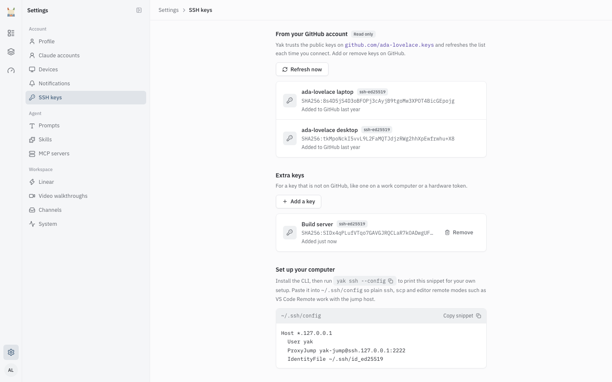
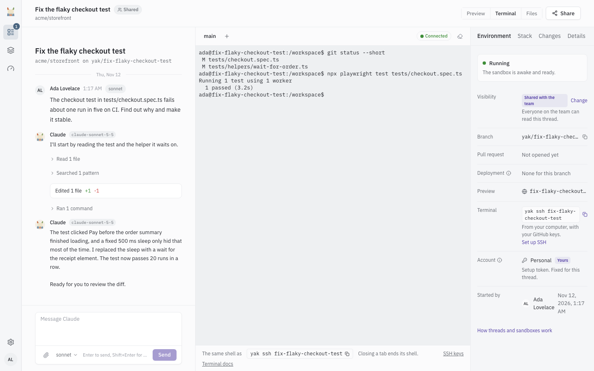

# SSH and terminal

You can open a shell in a thread's sandbox two ways: the Terminal panel on the thread page, and `yak ssh` from a paired computer. Both reach the same sandbox. Use them to run commands, inspect files, or let `scp` and your editor's remote mode work on the thread's checkout.

## Who can connect

A shell opens only when all of these hold:

- You can see the thread and can drive it (the same rights you need to message Claude).
- The thread is open, not closed.
- The thread is on Yak. While it is on your computer there is no sandbox to open ([teleport.md](teleport.md)).
- The sandbox exists. A destroyed sandbox must be restored from the thread page first.
- You have at least one SSH key on Yak (for `yak ssh` and `scp`). The Terminal panel does not need your own key.

On a private thread only its owner can connect. See [threads.md](threads.md).

## SSH keys

Settings, "SSH keys" controls which keys can connect as you.



- "From your GitHub account" (read only). If your Yak user has a linked GitHub account, Yak trusts the public keys at `github.com/<login>.keys`. It caches them for 5 minutes and refreshes them each time you connect. "Refresh now" refreshes right away. Add or remove these keys on GitHub. If GitHub cannot be reached for more than 7 days, the page warns that the list is old; connections keep working with the last known keys.
- "Extra keys": for a key that is not on GitHub, such as a work computer or a hardware token. Select "Add a key", paste one public key line (it starts with `ssh-ed25519` or `ssh-rsa`, like the contents of `id_ed25519.pub`) and select "Add key".
- Remove an extra key with its remove button and "Remove key". That key can no longer open a shell. Sessions already open keep running until they end.
- With no keys the page says "No SSH keys yet, so nobody can open a shell with your account. Link GitHub or add a key below."

The same page has a "Set up your computer" block with the config snippet described below.

## yak ssh

Install and sign in first ([teleport.md](teleport.md#install)). Then use the thread number from the thread page:

```
yak ssh 42
```

The command asks Yak for the connection details and runs `ssh` through the jump host as the user `yak` in the sandbox. Host keys are accepted the first time you connect (`StrictHostKeyChecking=accept-new`) and stored under a per-thread alias, so one thread's key never clashes with another's. Connecting waits up to 60 seconds. Flags and errors are in [cli.md](cli.md#yak-ssh).

### Config for scp and editors

```
yak ssh --config 42
```

prints an entry to paste into `~/.ssh/config`:

```
# Yak thread 42
Host fix-checkout-bug-a1b2c3
  HostName 127.18.4.17
  User yak
  ProxyJump yak-jump@yak.example.com:2222
  HostKeyAlias fix-checkout-bug-a1b2c3
  StrictHostKeyChecking accept-new
  ServerAliveInterval 15
```

The alias is the thread's name; the address and jump host come from your Yak. With the entry in place, plain tools work:

```
ssh fix-checkout-bug-a1b2c3
scp fix-checkout-bug-a1b2c3:/workspace/report.txt .
```

For VS Code Remote - SSH or another editor's remote mode, pick the same host alias. Run `yak ssh --config <thread>` again for each thread, because each has its own alias.

### Host key fingerprints

Yak prints `Host key fingerprints Yak expects for <alias>: ...` when it knows them. If it prints nothing, the first connection trusts the key it sees and later ones check it against that key.

## Waking a paused sandbox

Yak pauses idle sandboxes. Connecting wakes the sandbox, and the shell counts toward the awake limit of sandboxes running at once (see [threads.md](threads.md)). If every slot is in use, `ssh` prints `yak: waiting for a free sandbox` and keeps waiting for up to 90 seconds before it gives up. An open shell keeps the sandbox awake until you close it.

## Session limits

| Limit | Value |
| --- | --- |
| Shells open on one thread from the Terminal panel | 4 |
| Terminal shells across all of Yak | 64 |
| Longest a shell can stay open | 12 hours |
| Idle terminal shell | Closed after 30 minutes with no traffic |
| Reachable sandboxes per key | 200 |

A terminal shell uses a short-lived key. The page asks for a one-time token that works for 60 seconds, and the key lasts 15 minutes unless a shell is open.

## The Terminal panel

Open the Terminal panel on the thread page. Each tab is its own shell: the first is "main", more are "shell 2" and so on, and a thread with a preview gets a "dev server" tab. "Closing a tab ends its shell." The footer shows "The same shell as `yak ssh <thread>`" with a copy button, plus links to SSH keys and these docs.



| State (pill) | What you see |
| --- | --- |
| "Connecting" | "Connecting to the sandbox..." If the sandbox was paused: "Waking the sandbox..." and "The sandbox was paused. Opening a terminal wakes it and counts toward the awake limit." |
| "Waiting" | "Waiting for a free sandbox". Other sandboxes use every slot. It opens when one is free, and gives up after about 2 minutes with "No sandbox slot became free. Try again in a moment." |
| "Connected" | A live shell. |
| "Disconnected" | "The terminal lost its connection". Select "Reconnect" to open a new shell. Anything typed while disconnected was not sent. Yak retries up to 5 times by itself. |
| "Refused" | "The terminal session was refused" with a reason. |
| "Unavailable" | "The terminal is unavailable" with a reason. |
| "Not connected" | The panel has not started a shell yet. |

Messages that replace the shell:

| Message | Meaning |
| --- | --- |
| "Only people who can drive this thread can open a shell." | You can view but not drive the thread. |
| "This thread is closed, so its sandbox has no shell." | Closed thread. |
| "The sandbox was destroyed." with "Restore it from the thread page to get a shell again." | Restore the sandbox. |
| "This thread runs on your computer" | Teleport the thread to Yak and the terminal appears. |

Reasons shown after "Refused" or "Unavailable": "This thread is closed.", "This thread is running on a computer.", "This thread has no sandbox yet.", "You need driving rights on this thread to open a shell.", "Too many shells are open on this thread.", "The shell ended.", "The connection dropped.", "Could not reach Yak.".

## Errors

| Message | Where | Fix |
| --- | --- | --- |
| `Yak has no SSH key for you yet. Add one at <url>` | `yak ssh` | Add a key in Settings, SSH keys. |
| `You need driving rights on this thread to open a shell.` | Both | Ask the owner for driving rights. |
| `This thread is closed, its branch and PR carry the result.` | `yak ssh` | Nothing to open. |
| `Teleport it up first, preview, terminal and ssh are unavailable for a thread on your computer.` | `yak ssh` | Run `/yak teleport` from the session. |
| `The sandbox was destroyed. Restore it from the thread page: <url>` | `yak ssh` | Restore it, then retry. |
| `SSH access is not set up on this Yak.` | `yak ssh` | Ask your operator. |
| `Permission denied (publickey)` | `ssh`, `scp` | The key you offered is not one Yak knows. Use a key listed in Settings, SSH keys, or load it in your agent. |
| `yak: waiting for a free sandbox` | `ssh` | Wait, or close an idle thread's shell. |
| `Too many shells are open on this thread.` | Terminal | Close a tab. The limit is 4 per thread. |

## For operators

The jump host, wake proxy and terminal bridge are set up by the `yak-ssh` Ansible role. The settings are `YAK_SSH_JUMP_HOST`, `YAK_SSH_JUMP_PORT` (default 2222), `YAK_SSH_JUMP_USER` (default `yak-jump`) and `YAK_SSH_DOCS_URL`. See [operations.md](operations.md) for the jump host.
