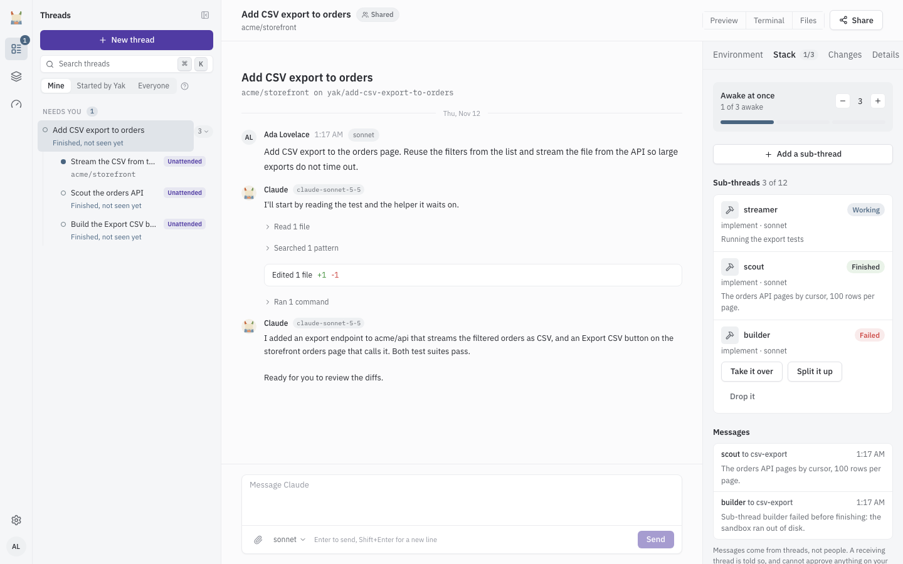

# Sub-threads

A sub-thread is a smaller thread that a thread hands a piece of work to. The parent and its sub-threads together are a stack. Use sub-threads to split a large job into parts that run side by side, or to send Claude off to research something without losing the main thread's context.

## How sub-threads start

Claude starts a sub-thread with a name, a kind, a brief, and optionally a model. You can also add one yourself (see below). A sub-thread runs on the same Claude account as its parent, and its page shows the brief it was given.

| Kind | What it is for |
|---|---|
| Implement | Code changes on its own branch, in its own sandbox that starts as a copy of the parent's. It can also work in another repository, in which case it opens its own pull request there. |
| Mockup | Like Implement, for visual work. Files it saves to `.yak-artifacts` are listed in its result. |
| Research | Reading and investigating. It runs in the parent's sandbox in a read-only copy of the code, takes no sandbox of its own, and never changes the parent's files. It sees every repository the parent has. |
| General | Any other work, in its own sandbox, without a branch. |

An Implement or Mockup sub-thread works on a branch named `yak/<parent branch>/<name>`.

## Add a sub-thread by hand

1. Open the thread and select the Stack panel.
2. Select "Add a sub-thread". The button shows only on a thread you can drive, and only while the thread runs on Yak (not on your computer).
3. Fill in the form.

| Field | Meaning |
|---|---|
| Name | A short name, up to 60 characters. |
| Brief | What it should do, what to leave alone, and what to hand back. |
| Kind | Implement, Research, Mockup or General. Default is Implement. |
| Model | Sonnet, Opus or Haiku. Default is Sonnet. |

4. Select "Start sub-thread". The dialog tells you how many sub-threads are awake and how many of 12 you have used.

A stack can hold up to 12 sub-threads.

## Rules

- A stack has one level. A sub-thread cannot start sub-threads of its own.
- A thread cannot start sub-threads when it is closed, when its stack was stopped, or while it runs on your computer. Bring it back to Yak first (see [Teleport](teleport.md)). You cannot start sub-threads from a local Claude Code session.
- Only Implement sub-threads can work in a different repository. A Research sub-thread sees every repository of its parent.
- A sub-thread and its parent can message each other, and so can siblings in the same stack. A sub-thread is told that its parent is an agent: it can answer from its plan but cannot approve anything for a person.

## The awake limit

Implement, Mockup and General sub-threads each hold a sandbox. The stack runs at most 3 of them awake at once by default (`YAK_THREADS_CHILD_AWAKE_LIMIT`). More wait in a queue ("Starts when another sub-thread finishes") and start in order as slots free up. Research sub-threads do not count.

The Stack panel shows "Awake at once", for example "2 of 3 awake", and how many are waiting. Use the stepper ("Allow one fewer", "Allow one more") to change the limit. It ranges from 1 up to your per-person awake sandbox limit (`YAK_THREADS_PERSON_AWAKE_CAP`, default 4). Your threads and their sub-threads all count toward that per-person limit and the host-wide limit, so a sub-thread can also wait for a sandbox. See [Threads](threads.md) for sandbox capacity.

## How results come back

When a sub-thread finishes, Yak pushes its branch (Implement and Mockup), destroys its sandbox, and queues its result for the parent. Results are delivered to the parent as one message once every sub-thread is done, or after 10 minutes (`YAK_THREADS_CHILD_RESULT_WAIT_MINUTES`), whichever comes first. A failure or a question goes to the parent at once. A sub-thread that works in another repository opens its own pull request, and the parent is told not to merge its branch.

If a sub-thread fails (its runner crashed, it hit the runaway guard, or it hit the Claude usage limit), nothing retries on its own. The parent is told, and you can step in.

## Controls

| Control | What it does |
|---|---|
| Stop stack | Stops every running turn in the thread and its sub-threads, kills Research sub-threads, drops sub-threads that were waiting for a slot, and blocks new sub-threads. Nothing is deleted. Asks "Stop the whole stack?" first. |
| Take it over | Results and failures of this sub-thread no longer go to the parent, and any result still waiting is dropped. You drive it from now on. Its row reads "Taken over". |
| Split it up | Tells the parent that you asked for this sub-thread's work to be split into smaller sub-threads or steps. |
| Drop it | Closes the sub-thread and tells the parent not to wait for its result. |

"Take it over", "Split it up" and "Drop it" appear on a sub-thread that failed, on the sub-thread's row in the Stack panel and on its card in the parent's conversation. They need the right to drive the thread.

## Where sub-threads show up

- In the thread list, sub-threads nest under their parent. Expand or collapse them with "Expand sub-threads" and "Collapse sub-threads". A parent whose sub-thread is waiting on you shows "N sub-threads need you".
- The parent's conversation shows a card per sub-thread with its kind, model, state, branch, change totals and result.
- A sub-thread's page shows a banner that it is a sub-thread, a link to its parent, and a "Brief from ..." card.
- The Preview panel gets a tab for each Implement or Mockup sub-thread that has a sandbox. See [Previews](previews.md#thread-previews).

## Visibility

A sub-thread uses the visibility of the top thread of its stack, and only that thread's owner can change it. See [Threads](threads.md) for private threads.

## Usage alerts

Yak tells the stack's owner when a stack crosses a usage mark. Each mark alerts once, and nothing is paused.

| Mark | Default | Setting |
|---|---|---|
| Turns | Every 50 turns | `YAK_THREADS_STACK_ALERT_TURNS` |
| Active hours | Every 3 hours | `YAK_THREADS_STACK_ALERT_HOURS` |
| Sub-threads started | Every 12 sub-threads | `YAK_THREADS_STACK_ALERT_CHILDREN` |

The owner is notified, and gets a push notification when "Stack usage alerts" is on. See [Notifications](notifications.md).
