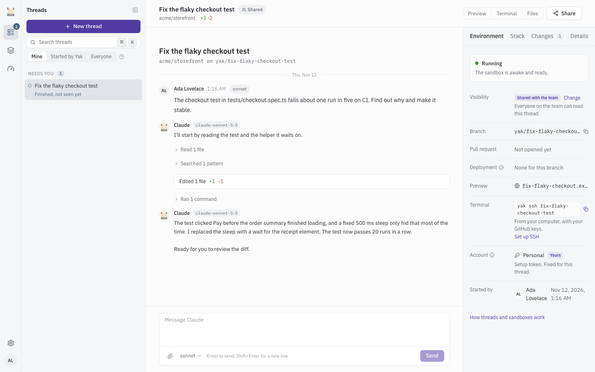
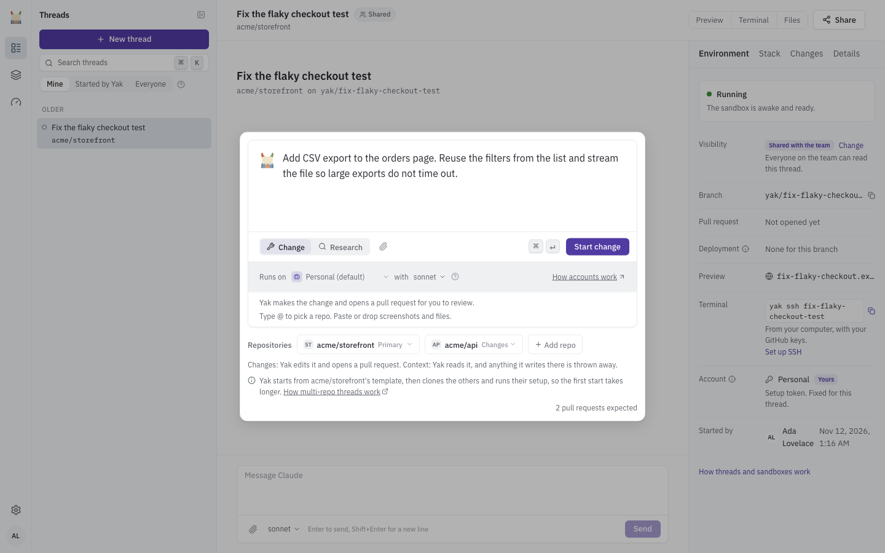
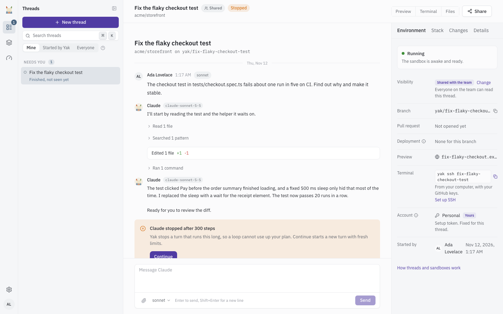
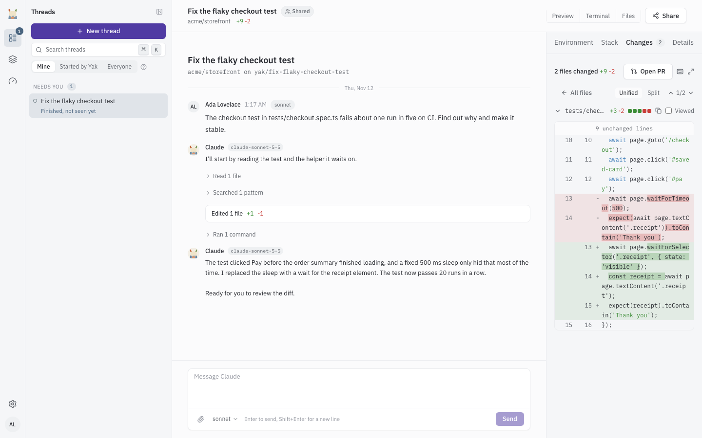
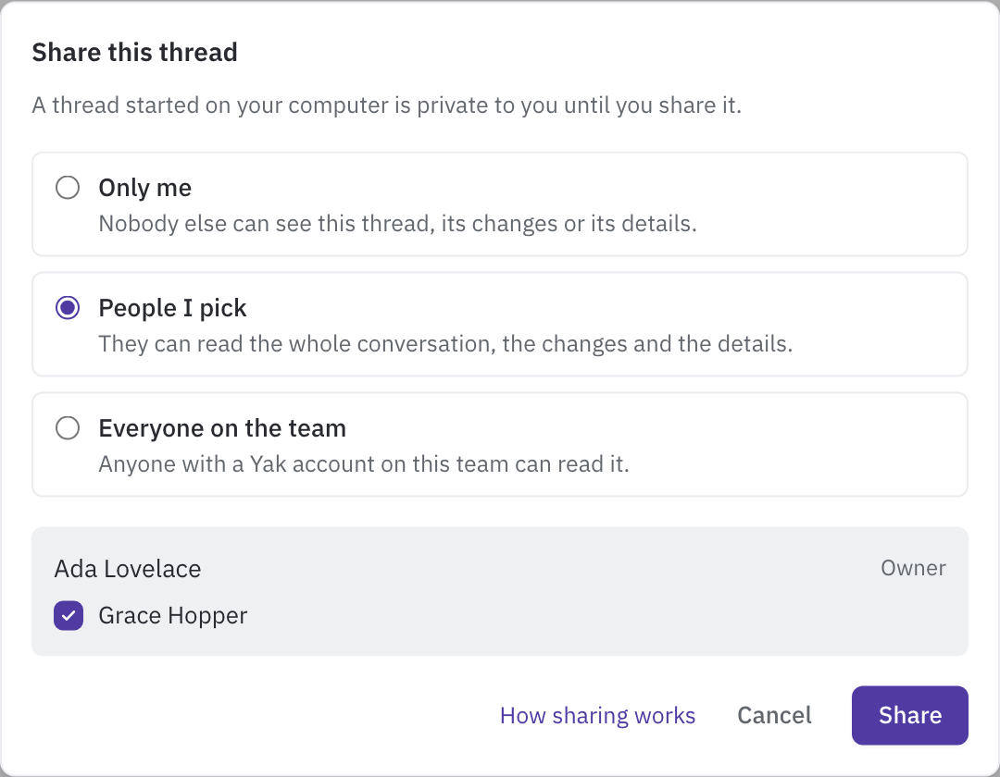
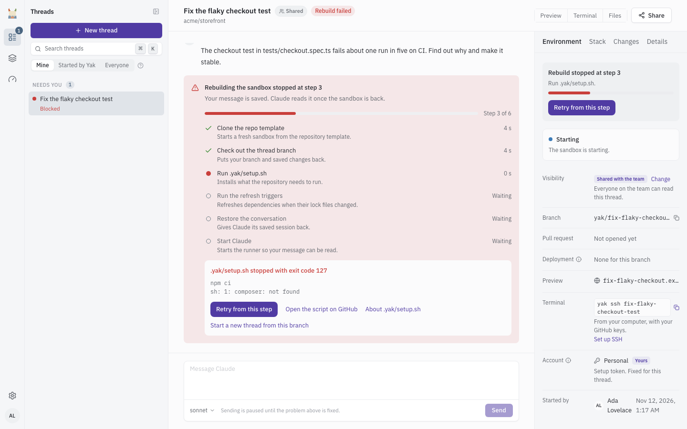

# Threads

A thread is where you work with Claude on a change or a piece of research. Start one from the dashboard, watch Claude work, send messages, review the changes and open pull requests. For the ideas behind threads, turns and tasks, read [Concepts](concepts.md) first.

## Start a thread

Select **New thread** at the top of the thread list, or press `C`. A dialog opens over the page you are on. Fill in the form and select **Start change** (or **Start research**). `Cmd+Enter` also starts it. The same form is also a page at `/threads/new`. On a new install with nothing set up, the home page (see [Dashboard pages](dashboard.md#home)) shows the form below a short checklist.

| Field | What it does |
| --- | --- |
| Description ("What should Yak do?") | Say what is wrong or what you want, and where to look if you know. Paste or drop screenshots and files to attach them. Type `@` to pick a repository. |
| Mode: **Change** | Yak makes the change and opens a pull request for you to review. With several changing repositories you get one pull request per repository. |
| Mode: **Research** | Yak investigates and writes a report. No pull request. Every extra repository becomes read-only context. |
| Primary repository | The repository the thread starts from. Pick it from the chip below the form. |
| **Add repo** | Adds up to 6 repositories in total. Each extra repository is **Changes** (Yak edits it and opens a pull request) or **Context** (Yak reads it, and anything it writes there is thrown away). Yak checks that it can reach the repository before the chip appears. See [Multi-repo threads](multi-repo.md). |
| Runs on (Claude account) | The Claude account the thread runs on for its whole life. The default is your default account. If you have no account yet, the form shows the shared account and a link to add your own. If no account works at all, you cannot start. See [Claude accounts](claude-accounts.md). |
| Model | The Claude model for the first turn. You can change it for any later message in the composer. |

After you start, a progress list shows each repository being prepared. The thread opens when the sandbox is ready. The first start takes longer with extra repositories, because Yak clones them and runs their setup.

## The thread list

The sidebar lists open threads (hide it with the panel button at the top of the list or the `[` key, and bring it back with **Show threads** on the icon rail), newest activity first, grouped as **Needs you**, **Today**, **This week** and **Older**. A search box filters by title or repository. Sub-threads sit under their parent (see [Sub-threads](sub-threads.md)). Closed threads leave the list. While you can see no thread at all, the list shows only "Your threads show up here" and hides search and filters. A filter or search with no result says "No threads here" or "No matches".

| Filter | Shows |
| --- | --- |
| **Mine** | Threads you started or took part in, plus unattended threads on repositories you follow |
| **Started by Yak** | Threads that came from a channel, such as Sentry or Slack, and have no person who started them |
| **Everyone** | Every thread you are allowed to see |

An **Unattended** badge means Yak started the thread, not a person (for example from a channel). Threads you may not see are never listed (see [Private threads](#sharing-and-private-threads)).

A thread moves to **Needs you** when something waits on you:

| Label | Meaning | What to do |
| --- | --- | --- |
| Asked you a question | Claude asked a clarifying question | Answer it in the thread |
| Blocked | The thread is waiting or stopped (a usage limit, no free sandbox, a failed rebuild) | Open the thread and read the card |
| Your token stopped working | The Claude account was rejected or expired | Replace the secret (see [Claude accounts](claude-accounts.md)) |
| Finished, not seen yet | A turn finished since you last opened the thread | Open it. The label clears |
| N sub-thread(s) need you | A sub-thread under this thread needs you | Open the parent and its stack |

You can also get a push alert for these (see [Notifications](notifications.md)).

## The composer

The composer sits under the conversation. It shows **Message Claude**. Press `Enter` to send and `Shift+Enter` for a new line. Attach files with the paperclip, or paste or drop them. The model picker sits beside the attach button.

What a message does depends on the thread:

- **No turn is running.** The message starts a new turn.
- **A turn is running.** The composer reads **Add a message. Claude reads it as soon as it can.** Yak hands the message to the running turn, which steers Claude mid-work. If it cannot be delivered, Yak queues it and Claude reads it as a follow-up when the current work is done.
- **The sandbox is rebuilding, the account is busy or the usage limit is hit.** The message is saved and Claude reads it when the turn can start. The composer says when.

The thread page has no list of queued messages. Edit or remove a queued message (switch it between **Queue** and **Steer**, edit it, or **Remove from queue**) on the task's page in the task log (Operations > Task log).

| Control | What it does |
| --- | --- |
| **Send** | Sends the message |
| **Stop** | Appears while a turn runs. Ends the turn now |
| **Continue** | Appears on the "Stopped" card after the runaway guard. Starts a new turn with fresh limits |
| `/clear` | Send `/clear` as the whole message to start a new thread continued from this one. It keeps the repository, branch, owner and visibility, and starts a fresh Claude session. This thread stays open and unchanged. You must **Stop** a running turn first |

The composer is disabled, with a short reason, when you can read but not send (**You can read this thread but not send messages.**), when the thread is closed, when it is on your computer (see [Teleport](teleport.md)), or when sending is paused until a problem is fixed.

### When a turn ends

A turn does not end the moment Claude writes its answer. Yak waits 30 seconds with no activity, and it never ends a turn while Claude has a tool call or a background task still running. During this window the header still shows **Working** and **Stop** stays visible. A message you send in that window is handed to the running turn instead of starting a new one. After the window the turn ends and the sandbox can pause. You can change the 30 seconds with `YAK_THREADS_TURN_GRACE_SECONDS`.

## Statuses

The pill beside the thread title shows what the thread is doing. It shows nothing when the thread is idle.

| Status | Meaning | What to do |
| --- | --- | --- |
| Working | A turn is running | Wait, steer, or **Stop** |
| Rebuilding | Yak is bringing the sandbox back | Wait. Your message is saved |
| Rebuild failed | A rebuild step failed | **Retry from this step** (see [Sandbox lifecycle and restore](#sandbox-lifecycle-and-restore)) |
| Waiting for the account | The account is already running its most turns at once | Wait. You see your place in line |
| Waiting for a sandbox | Every awake sandbox slot is in use, or you used your share | Wait. Yak starts the thread when a slot frees up |
| Token problem | The account token was rejected or expired, the account hit its usage limit, or a credential was exposed | Read the card. The owner of the account replaces the secret, or you start a new thread on your own account |
| Stopped | The runaway guard stopped the turn | Select **Continue** or send a message |

## The runaway guard

Yak stops a turn that runs too long, so a loop cannot use up your plan.

| Limit | Default | Config |
| --- | --- | --- |
| Steps (assistant messages) in one turn | 300 | `YAK_MAX_TURNS` (`yak.max_turns`) |
| Minutes of wall clock in one turn | 240 | `YAK_THREADS_TURN_WALL_CLOCK_MINUTES` |

When a limit is hit the status becomes **Stopped** and the conversation shows a card titled **Claude stopped after 300 steps** (or **after 240 minutes**). Select **Continue** to start a new turn with fresh limits, or send a message. A person who can drive the thread sees the button.

## The thread page

The header shows the title, a **Private** badge when it applies, the status, the share button and the dock toggles. Panels sit in two places.

- The right sidebar has **Environment**, **Stack**, **Changes**, **PRs** and **Details**.
- The dock opens beside the conversation and has **Preview**, **Terminal** and **Files**. Toggle each in the header.

### Environment

Shows where the thread runs: the sandbox state (Running, Starting, Paused, Stopped, Being removed, Removed), **Started on** (when it began on your computer), **Branch** (with a copy button), **Pull request**, **Deployment** (the branch deployment, see [Previews](previews.md#branch-deployments)), **Preview**, **Terminal**, **Account**, **Started by** and **Repositories**. A **Capacity, what is full** block shows turns on the account, awake sandboxes and your share when a limit applies. While the sandbox rebuilds it shows the step and **Retry from this step**.

### Changes

Shows the diff of what Claude changed, per repository. Pick a repository tab, filter files (press `/`), move between files (`j` and `k`), switch **Unified** or **Split**, and mark files as viewed. A pull request button, **Open PR**, sits at the top (see [Open a pull request](#open-a-pull-request)).

Limits: a diff over `YAK_THREADS_DIFF_MAX_BYTES` (1,048,576 bytes) is cut and some files are listed without their changes (**This diff is large, so some files are listed without their changes.**). Binary files show as **Binary file**. A **Context** repository shows a notice that its edits are discarded and offers to turn it into a repository with changes. Until Claude edits something the panel says **No changes yet**.

### PRs

Appears only when the thread has more than one repository or more than one pull request. Shows one card per pull request with its CI state (**CI passing**, **CI failing**, **CI running**, **Merged**, **Closed**). On a failing check, **Ask Claude to fix** sends the failure to Claude. A suggested merge order lists which pull request to merge first. You can reorder it. Yak never merges for you. See [Multi-repo threads](multi-repo.md).

### Details

Shows who owns the thread (**Owner**), since when, the **Account**, any **Held events** waiting while the thread is away, and the buttons **Teleport to your computer** and **Teleport to Yak**. See [Teleport](teleport.md).

### Stack

Lists the sub-threads of this thread, lets you **Add a sub-thread** and **Stop stack**. See [Sub-threads](sub-threads.md).

### Preview

Runs the branch's app in an iframe, with phone, tablet and desktop widths. See [Previews](previews.md).

### Files

Browse the sandbox files and edit text files in the browser. Switch between **Repository** and **Whole sandbox**. Save with `Cmd+S`.

- Only people who can drive the thread can save.
- Binary files are not shown. A file over `YAK_FILES_MAX_EDIT_BYTES` (1,000,000 bytes) is **Too large to edit in the browser**. The tree lists at most `YAK_FILES_TREE_LIMIT` (2,000) entries.
- If the file changed in the sandbox after you opened it, the save is refused and you compare **Your version** with **Claude's version**.
- After a save, Claude is told: "You edited path. Claude reads the change at its next step."
- System folders are read only. You can change anything under the home folder and the workspace.
- Files are unavailable while the thread is on your computer, closed, or has no sandbox. If the sandbox is stopped, opening Files wakes or rebuilds it.

### Terminal

A shell in the sandbox, in tabs. You need to be able to drive the thread. Opening a terminal wakes a paused sandbox, and an awake sandbox counts toward the awake limits. If every slot is taken, the terminal says **Waiting for a free sandbox** and opens when one frees up. It is unavailable while the thread is on your computer, closed or destroyed. To use your own terminal or editor, see [SSH](ssh.md).

## Open a pull request

Yak opens pull requests for review. You decide when.

1. Open the **Changes** panel.
2. Select **Open PR**. If the thread has several changing repositories, Yak opens one pull request per repository that changed, and links them.
3. If the thread is private, a dialog asks first (see below).

You need to be able to drive the thread. Yak never merges a pull request. Review and merge on GitHub.

## Sharing and private threads

A thread started on Yak is visible to the team by default. Select the share button in the header to change that. Only the thread's owner can open the dialog. Sub-threads follow their parent.

| Share mode | Who can read | Who can send messages |
| --- | --- | --- |
| **Only me** | Only you | Only you |
| **People I pick** | You, and the people you pick (the whole conversation, the changes and the details) | Only you |
| **Everyone on the team** | Anyone with a Yak account on the team | Anyone on the team |

A private thread (**Only me** or **People I pick**) is hidden from everyone else, administrators included. It does not appear in their list, and its address answers as if it did not exist. The thread shows a **Private** badge.

The dialog warns when Claude opened files whose names look like secrets. Yak does not remove secrets from transcripts, so everyone you share with can read what Claude saw.

When you open a pull request from a private thread, Yak asks **Open a pull request from a private thread?** The branch and a description written from the private conversation are published to GitHub. Select **Open PR anyway** to continue.

## Sandbox lifecycle and restore

The sandbox pauses when the thread is idle, stops after a while and is destroyed later. Yak may also remove a sandbox early to free disk or memory. Your branch, changes and conversation are kept. Send a message and Yak rebuilds the sandbox.

| Stage | When | Config |
| --- | --- | --- |
| Paused | After a turn ends and the sandbox is idle | |
| Stopped | The sandbox has been paused for 30 minutes | `YAK_THREADS_PAUSE_TO_STOP_MINUTES` |
| Destroyed | The sandbox has been stopped for 72 hours | `YAK_THREADS_STOP_TO_DESTROY_HOURS` |

A paused sandbox wakes in about a second. A stopped or destroyed one is rebuilt. The status shows **Rebuilding** with the step it is on, and your message is saved until Claude can read it. The steps are:

1. Clone the repo template
2. Check out the thread branch
3. Run .yak/setup.sh
4. Run the refresh triggers
5. Set up the extra repositories (only for multi-repo threads)
6. Restore the conversation
7. Start Claude

If a step fails, the status becomes **Rebuild failed**, the card shows the failed step with its error and the last lines of output, and sending is paused. Fix the cause if it is in your repository's setup, then select **Retry from this step**. Earlier steps are not repeated.

## Capacity limits

Yak runs a limited number of awake sandboxes. A thread that cannot get a slot waits (**Waiting for a sandbox**) and starts when one frees up. Yak stops a paused sandbox after 5 idle minutes to make room.

| Limit | Default | Config |
| --- | --- | --- |
| Awake sandboxes, all people | 8 | `YAK_THREADS_AWAKE_CAP` |
| Awake sandboxes, one person (their threads and sub-threads) | 4 | `YAK_THREADS_PERSON_AWAKE_CAP` |
| Awake sub-threads of one parent | 3 | `YAK_THREADS_CHILD_AWAKE_LIMIT` |
| Turns running at once on one Claude account | 16 | Set per account, from 1 to 64 (see [Claude accounts](claude-accounts.md#turn-limit-per-account)) |

You see them in the **Environment** panel (**Awake sandboxes**, **Your share** and **Turns on** the account) and on the waiting card in the conversation. The waiting card shows which sandboxes are running and which are paused, with their idle minutes. Admins can change the account limit per account (see [Claude accounts](claude-accounts.md)).

## When a thread closes

A closed thread is read-only, its sandbox is removed and it never reopens. A new message from a channel then starts a new thread. A thread closes when:

- every pull request of the thread is merged or closed
- it had no activity for 30 days and has no open pull request (`YAK_THREADS_DESTROY_DAYS`)
- all its work finished more than 24 hours ago and left no branch and no pull request (`YAK_THREADS_TERMINAL_CLOSE_HOURS`), as with research

A thread with an open pull request stays open until that pull request ends.

## Use a thread on a phone

On a narrow screen the thread page shows tabs instead of panels: **Chat**, **Preview**, **Terminal** and **Details**. A dot on **Chat** shows that Claude is working. **Details** holds the Environment, Stack, Changes, PRs and Details panels. On the **Terminal** tab a **Shell** and **Files** switch picks which one you see. Install Yak to your home screen to get push alerts (see [Notifications](notifications.md)).
