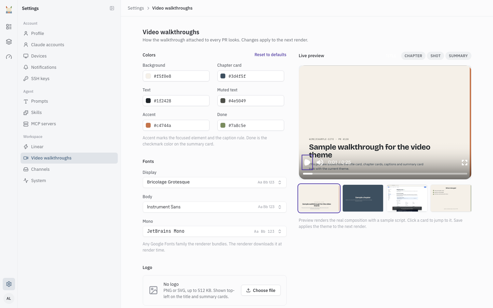

# Video Walkthroughs

When a change touches the UI, Claude records a walkthrough: a short video of the change working, built from a script Claude writes and a set of shots the sandbox captures. Yak renders the video and attaches it to the pull request. This page covers the installation-wide look of that video and the repository settings that affect it. For how the render pipeline works, see [Architecture](architecture.md#walkthrough-videos). If a specific video is missing or failed, see [Troubleshooting](troubleshooting.md#walkthrough-video-did-not-appear).

## Theming

Open **Settings > Video walkthroughs** (sign-in required, like every settings page). One theme applies to the whole installation. Saving a change never touches videos that already rendered. It applies from the next render.

### Colors and fonts

The page has six color fields:

| Field | Paints |
|---|---|
| Background | The page background behind every card |
| Chapter card | The chapter card fill |
| Text | Body text |
| Muted text | Secondary text |
| Accent | The focused element and the caption rule |
| Done | The checkmark on the summary card |

There are three font roles: **Display**, **Body** and **Mono**. Each picker offers only the Google Fonts families the renderer bundles, so you cannot save an unsupported family.

**Reset to defaults** puts the installation defaults back. Once you have saved the theme, changes to the host's default theme settings no longer show. Use **Reset to defaults** to make them apply again.

### Logo

Upload a PNG or SVG, up to 512 KB. It shows in the top-left of the title and summary cards. Yak rejects an SVG that is not well-formed XML or that contains scripts, `foreignObject` elements, event-handler attributes, external `href` references or animations that target them. Use **Remove** to go back to no logo.

### Render sample video

**Render sample video** queues a render of the current theme. Only one sample can render at a time. A **Download sample** link appears when it finishes, and the page checks for it every 10 seconds while a render is pending. If nothing appears after a few minutes, see [Troubleshooting](troubleshooting.md#walkthrough-video-did-not-appear).

### Live preview

The preview next to the fields needs a build file that the Docker image produces. Without it the page still saves, and only the preview player stays blank.

### Voiceover

Voiceover is read-only on this page. It shows **On** when the host has `ELEVENLABS_API_KEY` set. Without it, every walkthrough has captions only.

## Per-repository settings

The browser bar in each video shows a URL. By default that is the sandbox address. To show your public address instead, set a public site URL for the repository, in either place:

- **Public site URL** on the repository's page (see [Repositories](repositories.md#the-repository-page)). If `.yak/config.yml` sets it, the field is locked to the file value.
- `walkthrough.public_site_url` in `.yak/config.yml` (see [Repository config](repo-config.md#configyml)). It is an origin, up to 255 characters.

With neither set, the bar shows just the path with no host.
